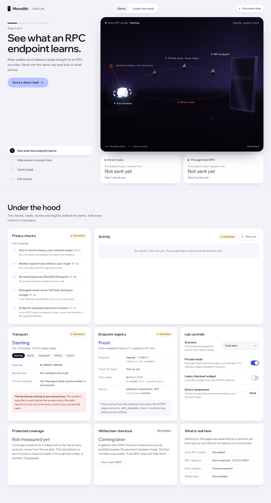
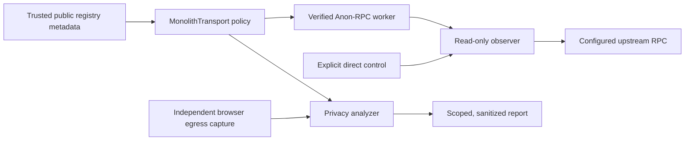

<a id="readme-top"></a>

<div align="center">

# Monolith

**The privacy crash-test lab for Web3 checkout.**

[](https://github.com/Dijo-404/monolith/actions/workflows/ci.yml) [](LICENSE) 

[Quick start](#quick-start) · [Usage](#usage) · [Documentation](#documentation) · [Contributing](#contributing)

</div>

<br/>

<p align="center">
  
  <br/>
  <sub>SIMULATED dashboard walkthrough. This screenshot contains fixture data.</sub>
</p>

> [!NOTE]
> **Early development.** The default dashboard is an interactive simulation; its controls make no application API or RPC requests, and payments are disabled. Supporting transport, observer, registry and regression modules are implemented separately. Live preflights have their own timestamped evidence; running the dashboard does not reproduce them.

## Overview

Monolith helps wallet and checkout developers catch accidental direct-RPC reads. It combines a visual Leak Lab, a fail-closed `MonolithTransport`, a controlled read-only observer, and an Arkiv-backed directory of public EVM endpoints. Independent browser egress checks compare observed requests with transport traces so a widget that bypasses the wrapper can become a reproducible regression.

### Features

- **Explore the leak.** A guided dashboard demonstrates direct reads, private routing, an injected bypass and a worker outage with explicit `SIMULATED` labels.
- **Enforce required privacy.** The transport validates supported reads and chain IDs through a verified Anon-RPC worker, or blocks without a direct fallback.
- **Check endpoint provenance.** Registry modules validate trusted publishers, source revisions, expiry and permitted origins before admitting candidates.
- **Observe a controlled comparison.** The observer permits five read methods against configured upstreams and retains bounded synthetic-run diagnostics for five minutes.
- **Catch regressions in CI.** Static boundary checks and independent Chromium capture detect direct bypasses; reports separate route protection from successful reads.

## Why Monolith

A checkout can route its balance lookup through an anonymity worker while a receipt widget or retry path still contacts the RPC provider directly. A transport wrapper alone cannot see calls that bypass it.

```text
Balance read  → MonolithTransport → verified worker → RPC
Receipt read  → direct fetch                        → RPC
               ↑ unexpected bypass under required privacy
```

Monolith combines transport policy with independently observed egress and reports the exact scope of each test. The destination still sees the JSON-RPC method and payload, including queried addresses.

> Protect the read's network path, catch the bypass, and show what remains visible.

## Requirements

| Requirement | Details |
| :--- | :--- |
| **Runtime** | Node **24.22.2**, pinned in [.node-version](.node-version); package engines require `>=24.22.2 <25` |
| **Package manager** | pnpm **12.18.0**, pinned in [package.json](package.json) |
| **Platform** | CI runs on Ubuntu; other platforms have not been verified here |
| **Browser** | A modern browser for the dashboard; Chromium for the documented browser regressions |
| **Optional** | Separate Playwright **1.65.0** tooling for [egress checks](tests/privacy/egress/README.md); live integrations need their documented operator configuration |

## Installation

Install from source after selecting the pinned Node version:

```sh
git clone https://github.com/Dijo-404/monolith.git
cd monolith
npm install --global pnpm@12.18.0
pnpm install --frozen-lockfile
cp .env.example .env
```

### Updating

From a clean checkout of `main`:

```sh
git pull --ff-only
pnpm install --frozen-lockfile
pnpm check
```

## Quick start

```sh
pnpm check  # run lint, type checks, offline tests and production builds
pnpm dev    # start the dashboard and observer with file watching
```

Open **http://127.0.0.1:5173** for the simulated Leak Lab. The observer listens at **http://127.0.0.1:3001**; check `GET /api/health` for its configured state. The default setup needs no wallet, signing key or live-network credentials. Observer upstreams and public registry discovery remain unavailable until configured.

## Usage

In the default dashboard, follow the four steps: send a direct read, compare the private route, inject a leaky widget, then try a worker outage. Inspect **Under the hood** for the scenario controls, activity and remaining payload exposure. These interactions use local fixtures.

### Commands

| Command | Description |
| :--- | :--- |
| `pnpm dev` | Start both development apps |
| `pnpm dev:dashboard` / `pnpm dev:observer` | Start one development app |
| `pnpm lint` | Check ESLint and architecture import rules |
| `pnpm typecheck` | Build package declarations and check workspace TypeScript |
| `pnpm test` | Run deterministic offline tests |
| `pnpm build` | Build packages, observer and dashboard in dependency order |
| `pnpm check` | Run lint, type checks, offline tests and builds |
| `pnpm start:observer` | Start the compiled observer after a build |
| `pnpm --filter @monolith/dashboard preview` | Preview the built dashboard locally |

### Examples

**Check browser network boundaries statically**

```sh
pnpm exec tsx scripts/check-rpc-egress.ts
```

For the reproducible leaking and repaired browser cases, follow the [egress guide](tests/privacy/egress/README.md). The leak command exits **1** and the fixed command exits **0** when their documented expectations hold. These checks use a synthetic driver and establish software behavior, with `SIMULATED` evidence.

**Query the accepted registry import independently**

```sh
pnpm --filter @monolith/shared build
pnpm --filter @monolith/registry build
pnpm exec tsx scripts/registry-query-example.ts --help
```

The [registry setup guide](docs/registry-setup.md) provides the live `--chain-id 10` command, trust pins, publisher references and failure behavior. That query contacts Arkiv directly for public metadata; expired or unavailable records fail without a saved-result fallback. It does not establish endpoint health or anonymity.

## Configuration

Both development apps read the root `.env`. Copy [.env.example](.env.example) and retain its defaults for the simulation:

```dotenv
MONOLITH_PUBLIC_OBSERVER_URL=http://127.0.0.1:3001
MONOLITH_OBSERVER_HOST=127.0.0.1
MONOLITH_OBSERVER_PORT=3001
MONOLITH_OBSERVER_ENDPOINTS=[]
MONOLITH_OBSERVER_SOURCE_MODE=unknown
MONOLITH_REGISTRY_CONFIG=
```

### Environment variables

| Variable | Effect |
| :--- | :--- |
| `MONOLITH_PUBLIC_OBSERVER_URL` | The only application environment value exposed to the browser; an HTTP(S) origin without credentials, path, query or fragment |
| `MONOLITH_OBSERVER_HOST` / `MONOLITH_OBSERVER_PORT` | Server listener address and port |
| `MONOLITH_OBSERVER_ENDPOINTS` | Server-owned approved HTTPS targets and contract-call rules; defaults to `[]` |
| `MONOLITH_OBSERVER_SOURCE_MODE` / `MONOLITH_OBSERVER_TRUSTED_PROXIES` | Declared source topology and exact trusted edge peers; defaults to inconclusive evidence |
| `MONOLITH_OBSERVER_LAB_RUNS` | Fresh synthetic run and baseline registrations; defaults to `[]` |
| `MONOLITH_OBSERVER_PUBLIC_LAB_RUNS` | Opt-in bounded public synthetic-run allocation; disabled by default |
| `MONOLITH_REGISTRY_CONFIG` | Server-only publisher, source-hash and origin policy for public discovery; disabled when empty |

See the [observer guide](docs/observer.md) and [registry setup](docs/registry-setup.md) before enabling network integrations. Automatic `VITE_` exports and prefix-based environment exports are disabled. Set `NODE_ENV` on the server process when deploying; keep signing keys out of browser configuration.

## Privacy and safety

- Required protected reads and chain-ID probes use a verified anonymizing worker or fail closed. Retries cannot silently downgrade to direct RPC. Passthrough earns no protected credit.
- Worker bootstrap is non-anonymous. Page/backend contact and public registry metadata queries are separate disclosed connections; Anon-RPC does not conceal them automatically.
- RPC destinations can read request methods and payloads. Public blockchain transfers remain visible. Protection applies only to the configured, measured read paths.
- The observer accepts configured endpoint IDs, with restricted read methods and contract calls. Client-supplied URLs, forwarding headers or route labels cannot establish destination trust or anonymity.
- Controlled comparisons temporarily retain source data in memory. Public diagnostics contain coarse source classes and synthetic IDs, expire after five minutes, and omit raw IPs and RPC bodies; deployment edges must also suppress raw-IP logs.
- Evidence distinguishes `OBSERVED_LIVE`, `SIMULATED`, `UNTESTED` and `BLOCKED`. Offline fixtures and screenshots cannot prove current live anonymity or payment settlement.

## How it works



This is the configured integration path supported by the modules. Registry discovery supplies candidates; publisher, expiry and origin policy plus a protected chain-ID probe determine admission. Independent egress capture complements transport traces to find bypasses. The default dashboard illustrates this flow with fixtures; live execution requires the separate integration setup and evidence described below.

## Tech stack

| Component | Tool |
| :--- | :--- |
| **Language and workspace** | [TypeScript](https://www.typescriptlang.org/) · [pnpm](https://pnpm.io/) |
| **Dashboard** | [React](https://react.dev/) · [Vite](https://vite.dev/) |
| **Read-only API** | [Fastify](https://fastify.dev/) |
| **Protected transport** | [Ethereum Anon-RPC browser harness](https://github.com/ethereum/anon-rpc) |
| **Registry** | [Arkiv SDK](https://docs.arkiv.network/) · [viem](https://viem.sh/) |
| **Checks** | [Vitest](https://vitest.dev/) · [Playwright](https://playwright.dev/) · [ESLint](https://eslint.org/) |

## Project structure

```text
.
├── apps/
│   ├── dashboard/            # React Leak Lab and browser composition
│   └── observer/             # Read-only RPC observer and public registry API
├── packages/
│   ├── transport/            # Read policy, worker lifecycle and adapters
│   ├── registry/             # Licensed import, trusted queries and endpoint policy
│   ├── privacy-analyzer/     # Coverage, findings and report redaction
│   └── shared/               # Versioned contracts and runtime validation
├── scripts/                  # Preflights, registry tools and deployment preparation
├── tests/                    # Offline fixtures and browser regressions
├── arkiv/                    # Schema, provenance, quality and consumer documentation
├── docs/                     # Design, integration and deployment guides
└── README.md
```

## Development

Read [the architecture](docs/architecture.md), [integration contracts](docs/contracts.md), [CONTRIBUTING.md](CONTRIBUTING.md) and [AGENTS.md](AGENTS.md) before making changes. GitHub issues hold live ownership and status; claim a ready task and use an isolated branch or worktree.

After installation:

```sh
pnpm check       # run the workspace's offline validation
pnpm test:watch  # iterate on unit and integration tests
```

CI runs the locked install and `pnpm check`. The separate [privacy workflow](.github/workflows/privacy.yml) runs browser egress regressions. Browser tooling and live preflights require explicit setup; they are not part of ordinary `pnpm check`.

## Troubleshooting

<details>
<summary><b>Installation reports an unsupported engine</b></summary>

Switch to Node **24.22.2**, then select the pinned package manager and reinstall:

```sh
npm install --global pnpm@12.18.0
pnpm install --frozen-lockfile
```

</details>

<details>
<summary><b>The observer or registry reports unavailable</b></summary>

The default environment enables no upstream targets or registry trust configuration. The simulated dashboard works without them. For live setup, follow the [observer configuration](docs/observer.md) and [registry setup guide](docs/registry-setup.md). An outage, expired registry record or inconclusive source topology must remain visible in the result.

</details>

## Limitations

- The default UI uses simulated scenarios. Integrated live dashboard execution and final release evidence are separate tracked work.
- Browser regression coverage is scoped to configured origins and ordinary Chromium HTTP traffic. It does not cover arbitrary third-party apps, wallet extensions, WebRTC/KPS traffic or every possible JavaScript bypass.
- Timestamped live evidence records a past run. Worker availability, endpoint freshness and network behavior must be checked again for a new run.
- Whitechain checkout remains conditional and disabled. No payment settlement or sponsor eligibility is claimed.

## Roadmap

- [x] Guided Leak Lab with explicit simulation labels
- [x] Fail-closed transport, controlled observer and trusted registry modules
- [x] Independent direct-bypass regression checks
- [ ] Integrated live dashboard and reusable public backend
- [ ] Reproducible live leak, repair and rerun walkthrough
- [ ] Accepted core evidence bundle and clean-clone release

## Documentation

| Guide | What's in it |
| :--- | :--- |
| [Project idea](docs/idea.md) | Product design, threat model and evidence gates |
| [Delivery plan](docs/plan.md) · [Task register](docs/task-register.md) | Dependencies, path ownership and GitHub issue links |
| [Architecture](docs/architecture.md) · [Integration contracts](docs/contracts.md) | Module boundaries, shared interfaces and trust rules |
| [Observer](docs/observer.md) | Read API, operator configuration, source topology and retention |
| [Registry setup](docs/registry-setup.md) · [Arkiv schema](arkiv/schema.md) | Independent queries, provenance, publisher policy and expiry |
| [Anon-RPC preflight](docs/preflight/anon.md) · [Observer preflight](docs/preflight/observer.md) | Reproduction steps, recorded observations and limits |
| [Egress checks](tests/privacy/egress/README.md) | Static boundaries and failing/passing browser regressions |
| [Deployment](docs/deployment.md) | Source-bound packaging, hosting preparation and publication state |

## Contributing

Read [CONTRIBUTING.md](CONTRIBUTING.md) before opening a PR. Use [GitHub Issues](https://github.com/Dijo-404/monolith/issues) for bugs and feature requests, and the [Agents view](https://github.com/Dijo-404/monolith/issues/views/MDQ6VmlldzI4MjE3) for shared task state. The [filtered task queue](https://github.com/Dijo-404/monolith/issues?q=is%3Aissue%20is%3Aopen%20label%3Aagents) is available if the saved view needs its filters adjusted.

## License

New project code is released under the [MIT license](LICENSE). Imported chain metadata retains the [ethereum-lists/chains MIT notice](packages/registry/src/adapters/source/LICENSE.ethereum-lists-chains). Bundled fonts and dependencies retain their own licenses.

## Acknowledgements

- [Ethereum Anon-RPC](https://github.com/ethereum/anon-rpc) for the browser harness and worker ecosystem.
- [Arkiv](https://docs.arkiv.network/) for the public entity store and SDK.
- [ethereum-lists/chains](https://github.com/ethereum-lists/chains) for redistributable EVM chain and RPC metadata.

<br/>

<div align="center">
  <sub>Built by <a href="https://github.com/Dijo-404">Dijo-404</a> · <a href="#readme-top">Back to top</a></sub>
</div>
