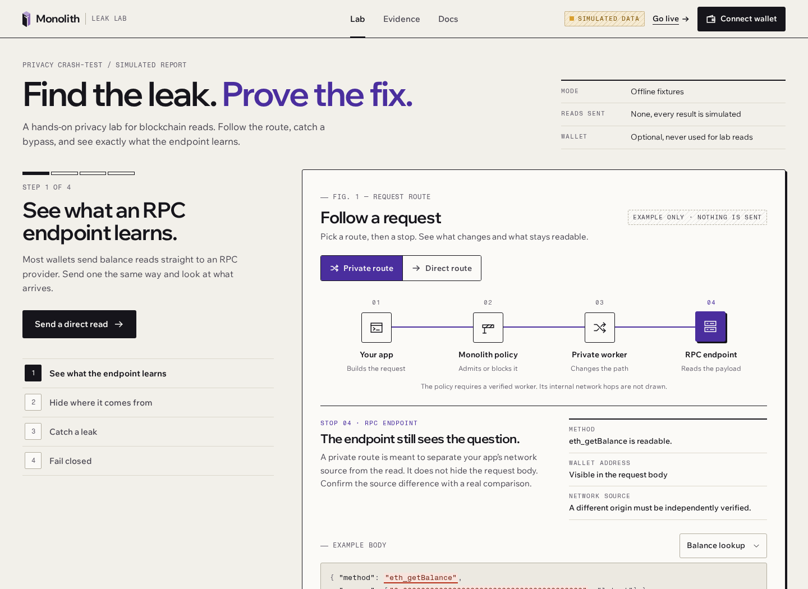
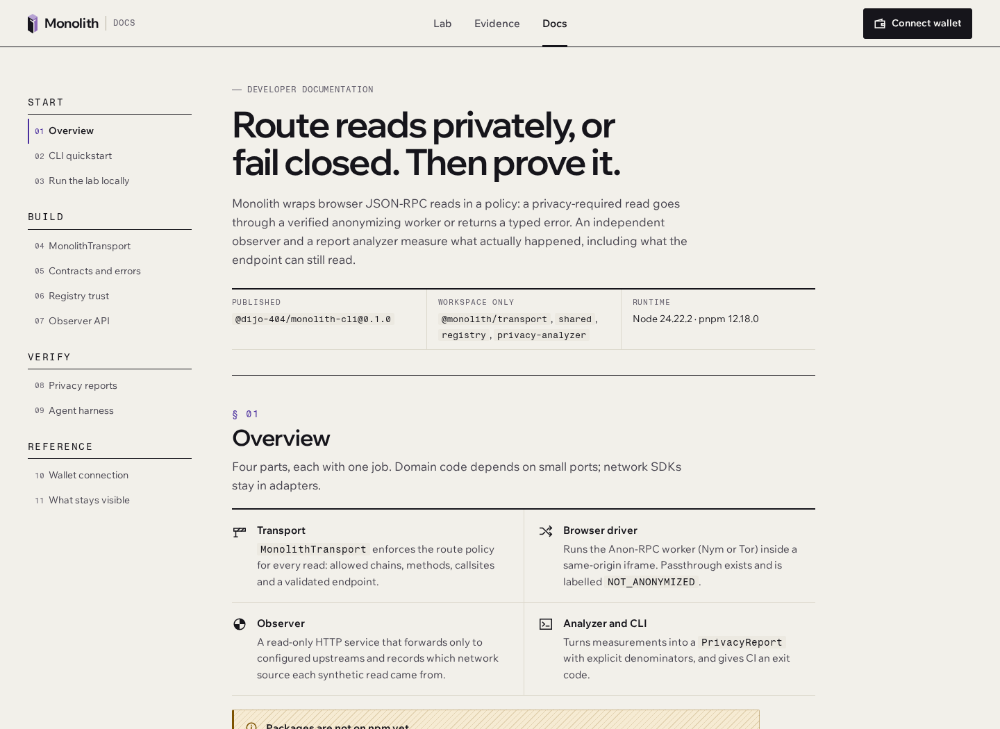
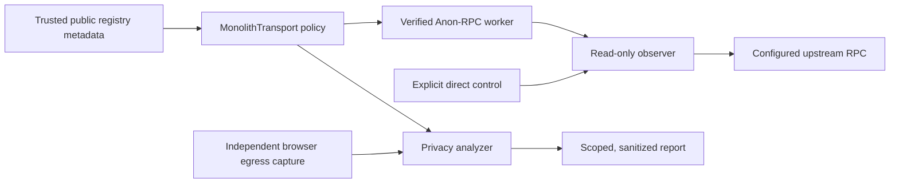

<a id="readme-top"></a>

<div align="center">

# Monolith

**The privacy crash-test lab for Web3 checkout.**

[](https://github.com/Dijo-404/monolith/actions/workflows/ci.yml) [](LICENSE) 

[Quick start](#quick-start) · [Dashboard](#dashboard-and-docs) · [CLI and TUI](#cli-and-tui) · [Agent harness](#agent-regression-harness) · [Documentation](#documentation)

</div>

<br/>

<p align="center">
  
  <br/>
  <sub>Latest dashboard preview · SIMULATED fixture walkthrough, before running a scenario. <a href="docs/images/readme-ui-20261107/README.md">Capture details</a>; presentation only.</sub>
</p>

The report-style dashboard, in-app Docs and optional wallet are available on `main` through [PR #112](https://github.com/Dijo-404/monolith/pull/112). The screenshots capture its earlier committed presentation revision; see the capture details for the exact source.

> [!NOTE]
> **Development preview.** The default dashboard is wired for live reads through a verified Nym worker. It makes no API or RPC requests on page load; run actions block before worker bootstrap with the example local configuration. The separate `?mode=simulated` walkthrough uses local fixtures. The CLI/TUI is available from source and on npm as `@dijo-404/monolith-cli` **0.1.0**; the public workflow (MN-014), leak/repair walkthrough (MN-016) and reusable backend (MN-025) are accepted for their recorded C11/Site7/runtime10 observation. The [core evidence package](docs/release-core.md) (MN-017) and hosted-release task (MN-023) still await normal owner acceptance. Payments are disabled.

## Overview

Monolith helps wallet and checkout developers catch accidental direct-RPC reads. It combines a visual Leak Lab, a fail-closed `MonolithTransport`, a controlled read-only observer, and an Arkiv-backed directory of public EVM endpoints. Independent browser egress checks compare observed requests with transport traces so a widget that bypasses the wrapper can become a reproducible regression.

### Features

- **Follow the request.** The latest UI pairs a four-step guide with a report-style request figure, explicit mode labels, direct/private result cards and inspectable read evidence. Its route explanations send nothing.
- **Explore the leak.** Configured live actions read through Nym, compare network sources, inject a fixed synthetic bypass, then reroute and rerun. A separate `SIMULATED` walkthrough includes local fixtures and worker-outage scenarios.
- **Enforce required privacy.** The transport validates supported reads and chain IDs through a verified Anon-RPC worker, or blocks without a direct fallback.
- **Check endpoint provenance.** Registry modules validate trusted publishers, source revisions, expiry and permitted origins before admitting candidates.
- **Observe a controlled comparison.** The observer permits five read methods against configured upstreams and retains bounded synthetic-run diagnostics for five minutes.
- **Catch regressions in CI.** Static boundary checks and independent Chromium capture detect direct bypasses; reports separate route protection from successful reads.
- **Work from the terminal.** The `@monolith/cli` prerelease analyzes local captures, displays sanitized report counts, checks prerequisites and opens the browser lab through commands or an interactive TUI.
- **Read the developer docs.** The new **Docs** view covers local setup, transport, contracts, registry trust, observer APIs, reports and the agent harness inside the dashboard.
- **Connect an installed wallet.** The optional EIP-6963 picker connects only after a choice, with account copy and disconnect. Wallet traffic is outside Monolith's protected read path; the lab keeps its synthetic address.
- **Review a bounded agent repair.** The repository-local harness detects a direct bypass, evaluates a candidate patch in a disposable copy and checks useful reads against the same independent privacy gate. Its available adapter is `SIMULATED`.
- **Prepare a reproducible deployment.** Source-bound static packaging, served-asset verification and a bounded temporary public observer launcher support separate deployment and live-workflow checks.

### Current status

Snapshot: **7 November 2026 (IST)**. GitHub issues hold live acceptance status.

| Area | Available now | Remaining work |
| :--- | :--- | :--- |
| **Protected reads** | Fail-closed transport and a [recorded real Nym/direct source comparison](docs/release-core.md#what-is-preserved) for C11/Site7/runtime10 | Recheck worker, registry freshness and backend availability for each new run |
| **Arkiv registry** | [100 distinct networks / 100 entities imported and independently queried](arkiv/data-quality.md), with publisher, provenance and expiry checks | Imported endpoints remain candidates; the import did not test their health or chain IDs |
| **Dashboard** | Report-style UI, Docs and optional wallet on `main`; accepted [public workflow](https://github.com/Dijo-404/monolith/issues/14) and [leak/repair walkthrough](https://github.com/Dijo-404/monolith/issues/16) at C11/Site7/runtime10 | [Core release acceptance](https://github.com/Dijo-404/monolith/issues/17); later runtime revisions need their own source-bound evidence |
| **CLI/TUI** | Published `@dijo-404/monolith-cli` **0.1.0**, local analysis, JSON output and terminal menu | [Core release acceptance](https://github.com/Dijo-404/monolith/issues/17) |
| **Agent harness** | [Repository-local simulated regression and patch verification](docs/agent-harness.md) for one maintained example app | Real worker/observer adapter and genuine external-agent live trial; [MN-029 acceptance](https://github.com/Dijo-404/monolith/issues/69) |
| **Deployment** | Accepted [reusable temporary backend](https://github.com/Dijo-404/monolith/issues/40) and retained Site7 asset/layout/fault checks | [Final hosted-release acceptance](https://github.com/Dijo-404/monolith/issues/36); workstation and free-provider continuity remain limited |
| **New integrations** | Tracked work for [Uniswap quote privacy tests](https://github.com/Dijo-404/monolith/issues/55) and [protected provider selection](https://github.com/Dijo-404/monolith/issues/56) | Integrated UI/backend behavior and live evidence; neither is a completed product feature |
| **Whitechain tracks** | Activated [Scale, Operate and Tokenize completion plan](docs/track-completion-plan.md#whitechain-shared-work) | Finish protected sponsored checkout, reusable merchant integration, asset lifecycle and track demonstrations |

`OBSERVED_LIVE` records describe their exact past runs. The [core evidence guide](docs/release-core.md) names the immutable C11 observation and C1 evidence candidate. C1 passed its recorded clean-clone checks and independent review; the final documentation candidate and [core release](https://github.com/Dijo-404/monolith/issues/17) still need their own validation and normal owner acceptance. Later software merges are not retrospectively observed by that capture.

## Why Monolith

A checkout can route its balance lookup through an anonymity worker while a receipt widget or retry path still contacts the RPC provider directly. A transport wrapper alone cannot see calls that bypass it.

```text
Balance read  → MonolithTransport → verified worker → RPC
Receipt read  → direct fetch                        → RPC
               ↑ unexpected bypass under required privacy
```

Monolith combines transport policy with independently observed egress and reports the exact scope of each test. The destination still sees the JSON-RPC method and payload, including queried addresses.

> Protect the read's network path, catch the bypass, and show what remains visible.

## Requirements

| Requirement | Details |
| :--- | :--- |
| **Runtime** | Node **24.22.2**, pinned in [.node-version](.node-version); package engines require `>=24.22.2 <25` |
| **Package manager** | pnpm **12.18.0**, pinned in [package.json](package.json) |
| **Platform** | CI runs on Ubuntu; other platforms have not been verified here |
| **Browser** | A modern browser for the dashboard; Chromium for the documented browser regressions |
| **Optional** | Separate Playwright **1.65.0** tooling for [egress checks](tests/privacy/egress/README.md); live integrations need their documented operator configuration |

## Installation

Install from source after selecting the pinned Node version:

```sh
git clone https://github.com/Dijo-404/monolith.git
cd monolith
npm install --global pnpm@12.18.0
pnpm install --frozen-lockfile
cp .env.example .env
```

### Updating

From a clean checkout of `main`:

```sh
git pull --ff-only
pnpm install --frozen-lockfile
pnpm check
```

## Quick start

```sh
pnpm check  # run lint, type checks, offline tests and production builds
pnpm dev    # start the dashboard and observer with file watching
```

Open **http://127.0.0.1:5173** for the live Leak Lab. Its run actions block with the example configuration; open **http://127.0.0.1:5173/?mode=simulated** for the offline fixture walkthrough. The local observer listens at **http://127.0.0.1:3001**; check `GET /api/health` for its configured state. Local startup needs no wallet, signing key or live-network credentials. Live actions require the public HTTPS observer, fresh public-run allocation, trusted Arkiv discovery and real Nym setup described in the [live lab guide](tests/e2e/lab-ui/README.md).

Open **http://127.0.0.1:5173/?page=docs** for the developer reference. The Docs view runs without mounting the lab or starting network requests.

## Usage

In the default live dashboard, follow the four steps: **Run private read**, **Compare direct and private**, **Send the leaky widget**, then **Reroute widget and rerun**. Each action opens a fresh bounded observer run. Comparison, leak and repair actions explicitly send a fixed synthetic direct control; the leak action adds a deliberate direct bypass. These requests expose your network source. Ordinary private reads use the verified worker or fail closed. Inspect **Under the hood** for receipts, activity and remaining payload exposure. See the [live lab guide](tests/e2e/lab-ui/README.md) for setup and the separate public-workflow evidence gate.

For the fixture walkthrough at `?mode=simulated`, send a direct read, compare the private route, inject a leaky widget, then try a worker outage. Its scenario controls use local fixtures and display `SIMULATED` labels.

### Dashboard and docs

The latest dashboard uses warm report paper, ink rules, authored line icons and compact annotations. Violet identifies the protected route; red identifies exposure. **Lab**, **Evidence** and **Docs** keep the walkthrough, actual run details and developer reference within reach, including on narrow screens.

**Fig. 1 — Request route** explains **Your app → Monolith policy → Private worker → RPC endpoint**. Select a stop or compare the Private/Direct explanations to see what each boundary changes. Balance and receipt examples use zeroed identifiers and show the method and payload the destination can still read. These controls are local explanations: actual requests come from the lab's run actions. **Inspect read** exposes a recorded read's route, outcome and evidence label without rendering raw RPC parameters.

The **Docs** view includes CLI quickstart, local setup, `MonolithTransport`, shared contracts/errors, registry trust, observer API, privacy reports, the agent harness, wallet connection and residual visibility. It is bundled with the app and works at `?page=docs` on a static host.

<details>
<summary>Preview the developer docs</summary>

<p align="center">
  
  <br/>
  <sub>Local documentation preview. No lab run or live integration result is shown.</sub>
</p>

</details>

### Wallet connection

Choose **Connect wallet**, select an installed EIP-6963 wallet and approve the account request. The account dialog shows the selected network and offers address copy and disconnect. Connection is optional, does not reconnect automatically and never substitutes your address into the lab's synthetic requests.

Choose **Switch to Whitechain Sepolia** in that dialog to request network **1874**. If your wallet does not know the network, it can ask you to add it before switching; the app then checks the selected chain. This action runs only when you click it.

The wallet manages its own RPC traffic outside Monolith's protection. Connecting it enables no signing, transaction submission or checkout payment. Whitechain settlement remains separately gated by its [preflight and completion work](docs/track-completion-plan.md#whitechain-shared-work).

### CLI and TUI

After installing the workspace, build the terminal package and run it from the repository root:

```sh
pnpm --filter @monolith/cli... build
node packages/cli/dist/monolith.mjs --help
node packages/cli/dist/monolith.mjs doctor --json
node packages/cli/dist/monolith.mjs check --input tests/e2e/cli/fixtures/simulated-pass.json --json
node packages/cli/dist/monolith.mjs tui
```

The check above uses a **SIMULATED** fixture. `check` analyzes local captured measurements; `report <file>` views sanitized report counts; `lab --url http://127.0.0.1:5173` asks the operating system to open the running browser app. `MONOLITH_LAB_URL` can supply the dashboard URL instead. The TUI requires an interactive terminal: use arrow keys or `j`/`k`, Enter to select, `?` for help and `q` to quit.

Use `--json` for automation. A `check` exits **0** only for a nonempty input passing privacy and useful-read checks, **1** for a failed check and **2** for invalid or unavailable input. Local files remain unverified caller input; the CLI does not authenticate captures or establish live privacy. Protected reads run through the browser worker.

The published package is [`@dijo-404/monolith-cli` **0.1.0**](https://www.npmjs.com/package/@dijo-404/monolith-cli). The internal workspace package remains `@monolith/cli`. See the [CLI guide](docs/cli.md) for installation, report format, CI behavior and release limits.

### Agent regression harness

The [agent harness guide](docs/agent-harness.md) walks through collecting a direct-bypass failure, giving an existing coding agent the diagnostic, then rerunning its bounded patch against the unchanged privacy and useful-read checks. The controller permits one specific example-file repair in a disposable copy, binds source/artifact hashes and leaves maintained source for human review.

This is a repository-local workflow through `scripts/agent-harness/main.mjs`, separate from the published CLI. Its browser scenarios use `SIMULATED` responses. Live mode currently returns `BLOCKED` before provider contact; the real adapter and live agent trial remain pending. A verified artifact manifest establishes byte consistency, not live anonymity.

### Commands

| Command | Description |
| :--- | :--- |
| `pnpm dev` | Start both development apps |
| `pnpm dev:dashboard` / `pnpm dev:observer` | Start one development app |
| `pnpm lint` | Check ESLint and architecture import rules |
| `pnpm typecheck` | Build package declarations and check workspace TypeScript |
| `pnpm test` | Run deterministic offline tests |
| `pnpm build` | Build packages, observer and dashboard in dependency order |
| `pnpm check` | Run lint, type checks, offline tests and builds |
| `pnpm start:observer` | Start the compiled observer after a build |
| `pnpm --filter @monolith/dashboard preview` | Preview the built dashboard locally |

### Examples

**Check browser network boundaries statically**

```sh
pnpm exec tsx scripts/check-rpc-egress.ts
```

For the reproducible leaking and repaired browser cases, follow the [egress guide](tests/privacy/egress/README.md). The leak command exits **1** and the fixed command exits **0** when their documented expectations hold. These checks use a synthetic driver and establish software behavior, with `SIMULATED` evidence.

<a id="query-the-accepted-registry-import-independently"></a>

**Query the accepted registry import independently**

```sh
pnpm --filter @monolith/shared build
pnpm --filter @monolith/registry build
env -u DEBUG -u ARKIV_PUBLISHER_KEY_FILE -u ARKIV_PUBLISHER_PRIVATE_KEY \
  pnpm exec tsx scripts/registry-query-example.ts --chain-id 10
```

The recorded production writer/owner is **`0x93D1A42655F2B0BCFa126e3D2a33e4ab60a74CA4`** on Arkiv Rabdi (chain **7794095**). The imported dataset is [ethereum-lists/chains at e174742](https://github.com/ethereum-lists/chains/tree/e17474286275730fb6b0490b1d7ea1c64a36ed9e), under its [immutable MIT license](https://github.com/ethereum-lists/chains/blob/e17474286275730fb6b0490b1d7ea1c64a36ed9e/LICENSE); the [notice is retained](packages/registry/src/adapters/source/LICENSE.ethereum-lists-chains). The [importer and recorded receipts](packages/registry/test/importer/README.md) document rerunning the import with a separately configured publisher.

The [registry setup guide](docs/registry-setup.md) provides trust pins, historical output and failure behavior. The query needs no signing key and contacts Arkiv directly for public metadata; expired or unavailable records fail without a saved-result fallback. Historical import success does not guarantee current availability, endpoint health or anonymity.

### Deployment

The [deployment guide](docs/deployment.md) and [static tooling guide](scripts/deploy/README.md) cover packaging an exact clean source commit, retaining licenses/provenance, verifying published asset bytes and checking deployed layout and worker-host failure behavior. The [public observer launcher](deploy/observer/README.md) exposes fixed approved routes, public registry metadata and fresh five-minute synthetic runs through a temporary HTTPS tunnel.

The temporary backend depends on its operator host staying online; provider retention and hostname lifetime are unverified. Packaging, a reachable health endpoint and static verification each have separate scope. The recorded C11/Site7/runtime10 workflow and backend have accepted evidence; final hosted-release and core-release acceptance remain pending, and a later selected build or backend needs its own applicable checks. Follow [public observer deployment](docs/observer-deployment.md) for those boundaries.

## Configuration

Both development apps read the root `.env`. Copy [.env.example](.env.example) for local startup. These defaults leave live actions blocked before worker bootstrap; the separate simulated walkthrough remains available:

```dotenv
MONOLITH_PUBLIC_OBSERVER_URL=http://127.0.0.1:3001
MONOLITH_OBSERVER_HOST=127.0.0.1
MONOLITH_OBSERVER_PORT=3001
MONOLITH_OBSERVER_ENDPOINTS=[]
MONOLITH_OBSERVER_SOURCE_MODE=unknown
MONOLITH_REGISTRY_CONFIG=
```

### Environment variables

| Variable | Effect |
| :--- | :--- |
| `MONOLITH_PUBLIC_OBSERVER_URL` | The only application environment value exposed to the browser; an HTTP(S) origin without credentials, path, query or fragment. Live actions require a public HTTPS origin |
| `MONOLITH_OBSERVER_HOST` / `MONOLITH_OBSERVER_PORT` | Server listener address and port |
| `MONOLITH_OBSERVER_ENDPOINTS` | Server-owned approved HTTPS targets and contract-call rules; defaults to `[]` |
| `MONOLITH_OBSERVER_SOURCE_MODE` / `MONOLITH_OBSERVER_TRUSTED_PROXIES` | Declared source topology and exact trusted edge peers; defaults to inconclusive evidence |
| `MONOLITH_OBSERVER_LAB_RUNS` | Fresh synthetic run and baseline registrations; defaults to `[]` |
| `MONOLITH_OBSERVER_PUBLIC_LAB_RUNS` | Opt-in bounded public synthetic-run allocation; disabled by default |
| `MONOLITH_REGISTRY_CONFIG` | Server-only publisher, source-hash and origin policy for public discovery; disabled when empty |

See the [observer guide](docs/observer.md), [registry setup](docs/registry-setup.md) and [live lab guide](tests/e2e/lab-ui/README.md) before enabling network integrations. A configured origin alone does not establish a working backend or accepted evidence: live actions also need fresh public-run allocation, matching approved upstream and registry policy, and a verified Nym worker. Automatic `VITE_` exports and prefix-based environment exports are disabled. Set `NODE_ENV` on the server process when deploying; keep signing keys out of browser configuration.

The live dashboard retries public registry metadata at most **three fresh queries**, only for typed availability or timeout failures. Trust, expiry, policy, chain and explicit rate-limit failures block. Every returned manifest is checked again against current trust and expiry; there is no stale-result fallback or direct protected-RPC downgrade.

## Privacy and safety

- Required protected reads and chain-ID probes use a verified anonymizing worker or fail closed. Retries cannot silently downgrade to direct RPC. Passthrough earns no protected credit.
- Worker bootstrap is non-anonymous. Run allocation, public registry metadata and diagnostics use ordinary page/backend connections; Anon-RPC does not conceal them automatically. Comparison, leak and repair actions explicitly send fixed synthetic direct requests; those direct requests earn no protected credit.
- Optional wallet connection uses the wallet's own provider outside Monolith's protection. The lab continues to use synthetic identifiers, and a connected wallet enables no checkout payment.
- RPC destinations can read request methods and payloads. Public blockchain transfers remain visible. Protection applies only to the configured, measured read paths.
- The observer accepts configured endpoint IDs, with restricted read methods and contract calls. Client-supplied URLs, forwarding headers or route labels cannot establish destination trust or anonymity.
- Controlled comparisons temporarily retain source data in memory. Public diagnostics contain coarse source classes and synthetic IDs, expire after five minutes, and omit raw IPs and RPC bodies; deployment edges must also suppress raw-IP logs.
- Evidence distinguishes `OBSERVED_LIVE`, `SIMULATED`, `UNTESTED` and `BLOCKED`. Offline fixtures and screenshots cannot prove current live anonymity or payment settlement.

## How it works



Configured dashboard actions follow this worker/observer path. Registry discovery supplies candidates; publisher, expiry and origin policy plus a protected chain-ID probe determine admission. The separate browser runner captures ordinary HTTP egress independently to find bypasses beyond transport traces. Live actions require the setup and accepted backend described in the [live lab guide](tests/e2e/lab-ui/README.md); implemented wiring alone does not establish a successful public run. The separate `?mode=simulated` walkthrough illustrates the flow with fixtures.

## Tech stack

| Component | Tool |
| :--- | :--- |
| **Language and workspace** | [TypeScript](https://www.typescriptlang.org/) · [pnpm](https://pnpm.io/) |
| **Dashboard** | [React](https://react.dev/) · [Vite](https://vite.dev/) |
| **Read-only API** | [Fastify](https://fastify.dev/) |
| **Protected transport** | [Ethereum Anon-RPC browser harness](https://github.com/ethereum/anon-rpc) |
| **Registry** | [Arkiv SDK](https://docs.arkiv.network/) · [viem](https://viem.sh/) |
| **CLI/TUI** | Node.js terminal I/O · [esbuild](https://esbuild.github.io/) |
| **Checks** | [Vitest](https://vitest.dev/) · [Playwright](https://playwright.dev/) · [ESLint](https://eslint.org/) |

## Project structure

```text
.
├── apps/
│   ├── dashboard/            # React Leak Lab, docs, optional wallet and browser composition
│   └── observer/             # Read-only RPC observer and public registry API
├── packages/
│   ├── cli/                  # Local analysis commands, report viewer and TUI
│   ├── transport/            # Read policy, worker lifecycle and adapters
│   ├── registry/             # Licensed import, trusted queries and endpoint policy
│   ├── privacy-analyzer/     # Coverage, findings and report redaction
│   └── shared/               # Versioned contracts and runtime validation
├── scripts/                  # Preflights, registry tools and deployment preparation
├── tests/                    # Offline fixtures and browser regressions
├── arkiv/                    # Schema, provenance, quality and consumer documentation
├── docs/                     # Design, integration and deployment guides
└── README.md
```

## Development

Read [the architecture](docs/architecture.md), [integration contracts](docs/contracts.md), [CONTRIBUTING.md](CONTRIBUTING.md) and [AGENTS.md](AGENTS.md) before making changes. GitHub issues hold live ownership and status; claim a ready task and use an isolated branch or worktree.

After installation:

```sh
pnpm check       # run the workspace's offline validation
pnpm test:watch  # iterate on unit and integration tests
```

CI runs the locked install and `pnpm check`. The separate [privacy workflow](.github/workflows/privacy.yml) runs browser egress regressions. Browser tooling and live preflights require explicit setup; they are not part of ordinary `pnpm check`.

## Troubleshooting

<details>
<summary><b>Installation reports an unsupported engine</b></summary>

Switch to Node **24.22.2**, then select the pinned package manager and reinstall:

```sh
npm install --global pnpm@12.18.0
pnpm install --frozen-lockfile
```

</details>

<details>
<summary><b>The observer or registry reports unavailable</b></summary>

The default environment enables no upstream targets or registry trust configuration, and its local HTTP observer origin cannot enable live actions. The default live lab blocks before worker bootstrap; `?mode=simulated` works with local fixtures. For live setup, follow the [observer configuration](docs/observer.md), [registry setup guide](docs/registry-setup.md) and [live lab guide](tests/e2e/lab-ui/README.md). An outage, expired registry record or inconclusive source topology must remain visible in the result.

</details>

## Limitations

- The reusable backend ([MN-025](https://github.com/Dijo-404/monolith/issues/40)), public dashboard workflow ([MN-014](https://github.com/Dijo-404/monolith/issues/14)) and leak/repair walkthrough ([MN-016](https://github.com/Dijo-404/monolith/issues/16)) are accepted for their recorded source and observation. [Core release](https://github.com/Dijo-404/monolith/issues/17) and [hosted-release](https://github.com/Dijo-404/monolith/issues/36) acceptance remain separate pending tasks; later runtime changes need applicable source-bound checks.
- Browser regression coverage is scoped to configured origins and ordinary Chromium HTTP traffic. It does not cover arbitrary third-party apps, wallet extensions, WebRTC/KPS traffic or every possible JavaScript bypass.
- Timestamped live evidence records a past run. Worker availability, endpoint freshness and network behavior must be checked again for a new run.
- Whitechain Scale, Operate and Tokenize are activated development targets. Complete the tracked checkout, reusable merchant integration, asset lifecycle and actual settlement evidence before enabling runtime payment controls.

## CROPS

Privacy is the lead property. These are the implementation's guarantees and trade-offs; the [submission audit](docs/prize-compliance.md) records unresolved qualification gates.

- **C — Censorship resistance:** The hosted domain, observer, Arkiv service and configured RPCs are dependencies; losing them blocks live reads. Users can run the source with their own compatible infrastructure; no automatic provider failover is promised.
- **O — Open source:** Code is MIT-licensed and builds locally with the pinned tools. Live use additionally needs the documented public-network configuration; repository metadata was observed PUBLIC on 6 November 2026 UTC through another session, which does not establish participant or sponsor eligibility.
- **P — Privacy:** The observer sees direct-control sources transiently; RPCs see methods and payloads; Arkiv/indexers see public metadata queries and their caller. Worker bootstrap and hosting contacts expose network metadata separately; authored client code adds no analytics, and deployed host-injected scripts need separate review.
- **S — Security:** Browser read mode handles no signing keys; the Arkiv publisher key stays with the operator and outside Git. Trusted publishers, fresh data, approved origins, worker integrity and protected chain probes gate reads; trust still includes the worker/network, host, observer topology and RPC responses.

## Hackathon submission and AI use

The owner confirmed **Classic / new project** registration and selected four development targets: **EF Anon-RPC/CROPS**, **Arkiv Mirror/Build from scratch**, **Uniswap Build**, and **Whitechain Scale/Operate/Tokenize**. The [track completion plan](docs/track-completion-plan.md) lists the implementation, tests, feedback and evidence to finish for every target, with linked GitHub tasks. The event permits selecting three partners at submission. See the [prize audit](docs/prize-compliance.md) for current evidence and submission requirements; planned work is not represented as completed integration.

AI coding assistants contributed planning, implementation, tests, documentation and review across this repository. [AI usage and prompt inventory](docs/ai-usage.md) identifies assisted files and reused assets, retains the available audit prompts, and explicitly records missing historical prompts and owner-supplied human-contribution details. This is an incomplete submission disclosure until those details are verified.

## Roadmap

- [x] Guided Leak Lab with explicit simulation labels
- [x] Fail-closed transport, controlled observer and trusted registry modules
- [x] Independent direct-bypass regression checks
- [x] Live dashboard composition with fail-closed configuration
- [x] Source CLI/TUI with local analysis, JSON output and portable tarball support
- [x] Source-bound deployment preparation and published-asset verification tooling
- [x] Accepted public dashboard workflow and reusable-backend evidence
- [x] Recorded live leak, repair and rerun walkthrough with source-bound reproduction instructions
- [x] Report-style dashboard, developer docs and optional wallet with explicit Whitechain network selection
- [x] Repository-local simulated agent regression and bounded patch-verification harness
- [ ] Real worker/observer adapter and external-agent live trial for that harness
- [ ] Accepted core evidence bundle and clean-clone release
- [x] Owner-approved npm CLI publication as `@dijo-404/monolith-cli` **0.1.0**
- [ ] Real protected Uniswap quote with bypass detection and useful repair
- [ ] Protected endpoint diagnostics and explicit provider selection
- [ ] Whitechain protected sponsored-USDT checkout and Scale demonstration
- [ ] Reusable merchant integration and Operate demonstration
- [ ] Contract-enforced asset lifecycle and Tokenize demonstration
- [ ] Complete partner feedback files, forms, videos and verified evidence bundle

## Documentation

| Guide | What's in it |
| :--- | :--- |
| [Project idea](docs/idea.md) | Product design, threat model and evidence gates |
| [Prize compliance](docs/prize-compliance.md) · [AI usage](docs/ai-usage.md) | Classic track requirements, source-linked evidence and unresolved submission gates |
| [Track completion plan](docs/track-completion-plan.md) | Full Uniswap and Whitechain Scale/Operate/Tokenize implementation and evidence checklist |
| [Delivery plan](docs/plan.md) · [Task register](docs/task-register.md) | Dependencies, path ownership and GitHub issue links |
| [Architecture](docs/architecture.md) · [Integration contracts](docs/contracts.md) | Module boundaries, shared interfaces and trust rules |
| [Observer](docs/observer.md) | Read API, operator configuration, source topology and retention |
| [Registry setup](docs/registry-setup.md) · [Arkiv schema](arkiv/schema.md) | Independent queries, provenance, publisher policy and expiry |
| [Arkiv data quality](arkiv/data-quality.md) · [Independent consumer](arkiv/reach.md) | Recorded import counts, actual storage/query evidence and remaining endpoint limits |
| [How Arkiv is used](arkiv/how-you-use-arkiv.md) | Query fields, entity permissions, expiry and visible product behavior |
| [CLI and TUI](docs/cli.md) | Local build/tarball install, analysis input, JSON output and exit codes |
| [Agent harness](docs/agent-harness.md) | Bounded candidate patches, independent privacy/useful-read checks, artifact verification and live-mode limits |
| [Dashboard product](apps/dashboard/PRODUCT.md) · [Design](apps/dashboard/DESIGN.md) | UI behavior, presentation rules and evidence boundaries |
| [Live lab](tests/e2e/lab-ui/README.md) | Nym/observer/registry wiring, bounded metadata retries and actual public-workflow acceptance |
| [Anon-RPC preflight](docs/preflight/anon.md) · [Observer preflight](docs/preflight/observer.md) | Reproduction steps, recorded observations and limits |
| [Egress checks](tests/privacy/egress/README.md) | Static boundaries and failing/passing browser regressions |
| [Core evidence](docs/release-core.md) | Named C11 observation, unchanged report bundles, exact-candidate validation and remaining release limits |
| [Deployment](docs/deployment.md) | Source-bound packaging, hosting preparation and publication state |
| [Static deployment tools](scripts/deploy/README.md) · [Public observer](deploy/observer/README.md) | Exact-source packaging, served-asset checks, temporary backend setup and teardown |
| [Swarm deployment](deploy/swarm/README.md) · [Swarm evidence](arkiv/swarm.md) | Gateway preflight, source-bound frontend artifacts, release descriptors and observed hosting limits |

## Contributing

Read [CONTRIBUTING.md](CONTRIBUTING.md) before opening a PR. Use [GitHub Issues](https://github.com/Dijo-404/monolith/issues) for bugs and feature requests, and the [Agents view](https://github.com/Dijo-404/monolith/issues/views/MDQ6VmlldzI4MjE3) for shared task state. The [filtered task queue](https://github.com/Dijo-404/monolith/issues?q=is%3Aissue%20is%3Aopen%20label%3Aagents) is available if the saved view needs its filters adjusted.

## License

New project code is released under the [MIT license](LICENSE). Imported chain metadata retains the [ethereum-lists/chains MIT notice](packages/registry/src/adapters/source/LICENSE.ethereum-lists-chains). Bundled fonts and dependencies retain their own licenses.

## Acknowledgements

- [Ethereum Anon-RPC](https://github.com/ethereum/anon-rpc) for the browser harness and worker ecosystem.
- [Arkiv](https://docs.arkiv.network/) for the public entity store and SDK.
- [ethereum-lists/chains](https://github.com/ethereum-lists/chains) for redistributable EVM chain and RPC metadata.

<br/>

<div align="center">
  <sub>Built by <a href="https://github.com/Dijo-404">Dijo-404</a> · <a href="#readme-top">Back to top</a></sub>
</div>
