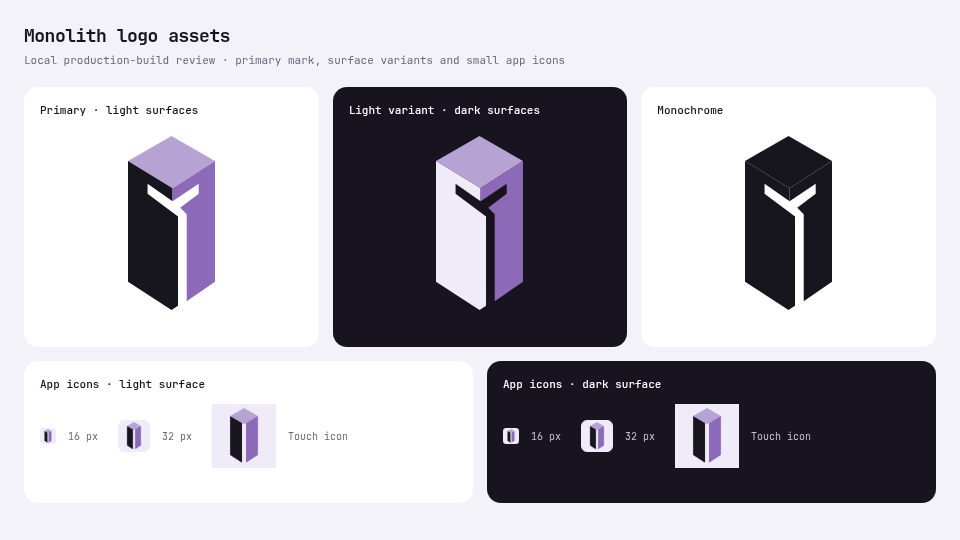

# Logo implementation review

Issue: [#100](https://github.com/Dijo-404/monolith/issues/100). The selected concept is rebuilt as a flat, minimal vector, with matching local header, favicon and touch-icon assets. [Usage and exports](README.md) describe the variants and reproducible raster commands.

The existing shared `Mark({ size })` API remains decorative beside the visible Monolith name. Both live and simulated entry modes use it. No Header, styles, live controller, transport, registry, backend, manifests, lockfile, existing evidence or deployment configuration changed. The separately held UI revision, PR89, remains outside this change.

## Validation

Pinned Node 24.22.2 and pnpm 12.18.0; Playwright 1.65.0 with local Chromium.

- `pnpm install --frozen-lockfile --offline --ignore-scripts`: 242 packages reused, zero downloads; lockfile unchanged.
- `pnpm check`: lint, all workspace types, 1,901 tests in 57 files and all builds passed.
- Final dashboard focused ESLint, typecheck and build passed. `pnpm --filter @monolith/dashboard exec vite build --base=/monolith/ --outDir=/tmp/monolith-logo-base-dist-20261107` passed for an independent subpath build.
- Direct `inspectDistribution('./apps/dashboard/dist')` from `scripts/deploy/prepare-static.mjs` passed: 16 static files, including all seven brand assets. New files stay within the accepted `assets/**` packaging boundary.
- Four SVG files parsed as XML; all seven usage-document links resolve. ImageMagick inspection confirms transparent 512 × 512 logo and 32 × 32 favicon PNGs, plus an opaque 180 × 180 touch icon. Whitespace checks passed.
- Independent production-browser review: 12 header cases passed, covering live/simulated modes at 320/390/1440px on both root and `/monolith/` previews. Assets decode at both bases, header has no horizontal overflow, and the accessible brand name appears once. Two keyboard checks retain visible 2px focus outlines.
- Four light/dark asset sheets passed; 16px and 32px icons were visually inspected. Zero page errors, external requests or application API requests occurred. No lab action or live read was initiated.
- Independent code review approved API compatibility, accessibility, base URLs, SVG contents and static packaging. Root reviewed the final exported PNG, brand sheet and mobile header.

[Machine results and input hashes](review.json), [mobile header](live-320-header.png), [desktop header](live-1440-header.png).

These are actual local software/rendering observations. Simulated fixture UI and unconfigured live-idle UI were inspected; this report establishes no live anonymity, registry, payment, hosting, physical-device or sponsor acceptance. Existing evidence remains historical and unchanged. Source work is prepared for owner review; no deployment is part of this task.
