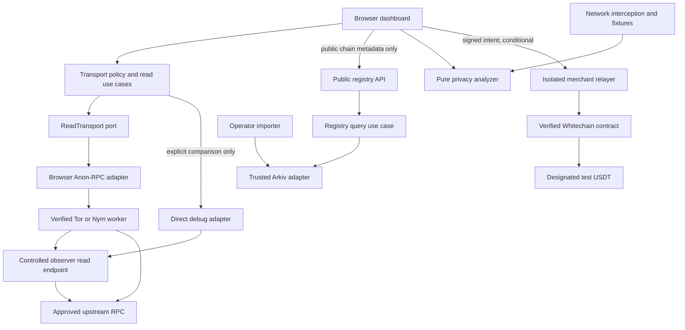

# Monolith architecture

Status: proposed implementation boundaries, derived from [idea.md](idea.md). No runtime integration, deployment, payment, or test outcome is implied by this plan. Team workflow lives in [CONTRIBUTING.md](../CONTRIBUTING.md); integration contracts live in [contracts.md](contracts.md).

## Shape and scope

Use a TypeScript modular monorepo: one browser app, a small observer/public-registry API, and an optional isolated payment relayer. React/Vite, Fastify, viem, the official Anon-RPC browser harness, and the Arkiv SDK are the blueprint's intended tools. Pin versions after the relevant preflight; the snippets in the idea are design inputs, not compiled interfaces.

The first working slice is a real protected read, a paired direct comparison, and a privacy regression that fails and then passes. Arkiv adds a live, trustworthy public endpoint directory. Whitechain adds payment only after the core and payment feasibility gates pass. The four-person team should keep these trust boundaries without introducing queues, databases, microservices, or generic repositories for future needs.



The diagram shows runtime flow. The code dependency direction is inward: application use cases depend on domain rules and small ports; adapters implement those ports. Composition roots construct concrete adapters. Domain and application modules never import a browser harness, Arkiv SDK, Fastify, React, environment variables, or signing keys.

## Layout and ownership boundaries

These paths are planned; the foundation task creates them. A package needs only the layers it uses.

```text
apps/
  dashboard/src/
    features/{lab,registry,checkout}/ # UI and presenters; checkout conditional
    composition/                   # browser adapters and feature wiring
  observer/src/
    domain/                        # permitted methods, source evidence, retention
    application/                   # observe read, retrieve sanitized run diagnostics
    adapters/{http,upstream}/       # Fastify routes and controlled upstream fetch
    composition/                   # mounts observer + public registry routes
  relayer/src/                     # conditional; separate server/key boundary
    {domain,application,adapters,composition}/
packages/
  shared/src/                     # DTOs, runtime schemas, safe error codes only
  transport/src/
    domain/                       # route policy, worker state, endpoint rules
    application/                  # initialize, validate endpoint, execute read
    ports/                        # ReadTransport, TraceSink, Clock
    adapters/{browser,test}/       # Anon-RPC, explicit debug, deterministic fakes
  privacy-analyzer/src/           # pure coverage, policy findings, report redaction
  registry/src/
    domain/                       # provenance, publisher/freshness, endpoint policy
    application/                  # normalize/import/query/select manifest
    ports/                        # public entity read/write, source snapshot, clock
    adapters/{arkiv,source}/       # SDK and licensed source-specific parsing
contracts/                        # conditional Foundry package, no assumed vault path
scripts/                          # thin operator/CLI composition roots
tests/{e2e,privacy,fixtures}/      # cross-package acceptance; synthetic data only
arkiv/                            # required evidence-backed integration documents
evidence/                         # generated, redacted evidence; never fabricated
```

| Module | Allowed dependencies | Public responsibility |
|---|---|---|
| `shared` | Schema/validation utilities only | Versioned DTOs and error vocabulary |
| `transport` core | `shared` | Fail-closed reads, endpoint validation, traces |
| `transport` browser adapter | Core, harness, browser APIs; viem only if needed | Worker lifecycle and correctly bound `worker.fetch` |
| `privacy-analyzer` | `shared` | Deterministic findings and measured denominators |
| `registry` core | `shared` | Licensed provenance, trusted publishers, fresh manifests |
| `registry` adapters | Core, SDK/source tools | Actual Arkiv writes/queries and source normalization |
| `dashboard` | Public package entry points | UI state, consented controls, browser composition |
| `observer` | `shared`, public `registry` exports | Controlled reads, public registry cache, ephemeral diagnostics |
| `relayer` | `shared`, viem, its own ports | Validate and submit bounded payment authorization |
| Root scripts/tests | Public entry points and test-only adapters | CLI composition and cross-module verification |

Export public entry points and separate browser/server adapter subpaths. No package may import an `apps/` module or another package's internal paths. `transport` receives a validated public manifest through the application boundary; it does not call the Arkiv SDK. `shared` must not become a utilities dump. Feature owners own implementation internals; shared schema changes require an explicit dependency review and coordinated consumer update.

## Dependency order and parallel development

1. Foundation freezes the DTOs and establishes workspace exports, lint/import boundaries, fixtures, and CI commands. Teammates can review these docs and run isolated feasibility experiments before that merge.
2. Transport, observer, registry, and UI/analyzer can then develop against the same small fixtures and ports. A fake adapter always emits `SIMULATED` provenance; it cannot substantiate anonymity or sponsor completion.
3. Merge each working capability into `main` through its own reviewed PR. Integration tasks start from the newly merged dependencies. Existing branches can consume a dependency through a documented temporary stacked PR, but must name the parent branch and be retargeted/rebased after its merge.
4. Payment remains disabled in ordinary demo configuration until its feasibility and activation evidence exists. Its private keys, RPC writes, and funding are isolated from the observer and dashboard build.

## Read initialization without a privacy loophole

1. Fetch the same public registry manifest used by all visitors; it contains chain IDs, public endpoint identifiers, expiry, publisher and provenance. This metadata request carries no wallet address or session-specific lookup. Disclose it as ordinary page/backend contact; routing it through the worker later is optional.
2. Locally validate the manifest publisher policy, freshness, expected chain, permitted HTTPS host and URL shape before any destination request. This produces a candidate, not a trusted live chain result.
3. Bootstrap the approved worker through the configured trusted bootstrap provider. The specifier lookup is a narrowly enumerated, non-anonymous bootstrap exception, displayed and recorded separately. It may not read a checkout balance or payment status.
4. When the real worker is ready, issue `eth_chainId` to the candidate through that worker. Reject a mismatch or failure. Cache validation only for a bounded lifetime and the exact endpoint, expected chain, manifest revision, and worker lifecycle.
5. Execute app reads through the same protected adapter; retries and alternate endpoints repeat this protected validation. Timeout, failed integrity checks, unsupported method, or unavailable network becomes a visible error without a direct fallback.
6. An explicit lab comparison uses a separate debug policy and direct adapter. Its reads remain visible in reporting but never increase protected coverage. Ordinary app configuration disables that adapter. Closing/replacing a worker invalidates readiness and endpoint validation.

The policy state machine distinguishes `BOOTSTRAPPING`, `READY`, `DEGRADED`, `BLOCKED`, and `CLOSED`. `READY` means the configured worker and required target checks passed; it is not a claim that all traffic or public transfers are anonymous. Passthrough is always `NOT_ANONYMIZED`.

## Registry and observer trust

The operator importer writes public licensed source snapshots to Arkiv with immutable source revision/hash, actual record counts and expiry. The reader filters creator and owner according to an explicitly configured publisher policy and validates content; a matching schema tag alone proves nothing. A second CLI queries Arkiv independently. The public API is mounted in `apps/observer` but uses the registry package's use case and scheduled/shared cache, avoiding per-wallet chain queries.

Discovery does not authorize network access. A registry URL must also pass deployment policy before probing. Reject credentials, API-key templates, non-HTTPS URLs, localhost, reserved/private/link-local IPs, malformed hosts and prohibited ports. Server-side probes validate DNS answers and bind the connection to the checked public destination; redirects are disabled or separately revalidated. Do not pass a validated URL into a new resolver path that can resolve it differently. Browser code uses a configured approved-host set; it must not claim browser URL checks alone defeat DNS rebinding.

The observer maps an opaque `endpointId` to an operator-approved upstream. It never forwards to a caller-provided URL, writes transactions, accepts arbitrary `eth_call` targets, or trusts an `x-forwarded-for` header from an unknown peer. An edge-proxy deployment must configure trusted proxies and suppress raw-IP access logs at both layers. Compare socket-derived observations with an ephemeral direct baseline; return `unknown` if reliable source evidence is unavailable. A caller's declared route label is not proof of routing.

The anonymous read endpoint may need worker-compatible CORS, including null-origin sandbox traffic. Treat it as a public read-only endpoint with no cookies or credentialed access, strict limits and body/method validation. Do not copy that policy to the authenticated relayer. Diagnostics expose only coarse classes and synthetic test identifiers, expire quickly, and never export raw IPs or request payloads. Retaining a source address briefly in memory to compare a run still requires disclosure and a fixed expiry; it must not enter logs or artifacts.

If Arkiv is down, the MVP blocks registry-dependent selection. An optional cache fallback must be a previously validated, signed snapshot with a pinned verification key, unexpired data and displayed age/provenance. An unsigned or expired JSON file must not silently enable routing.

## Evidence and privacy regressions

Transport traces explain instrumented calls. Playwright observes known external RPC egress and the observer origin independently to catch calls that bypass the wrapper. A static boundary rule forbids raw RPC fetches/provider defaults outside approved adapters and the isolated negative fixture. The report names the fixture origins, exclusions, bootstrap operations, scenario seed, and measured numerator/denominator; zero eligible reads yields `null` coverage, never 100%.

Mocked worker success proves application logic only. A live claim requires a verified Tor/Nym worker plus paired observer evidence. The destination still reads JSON-RPC payloads. Reports redact raw addresses, IPs, order data, keys, signatures, and stable session identifiers. Generate evidence after execution, include observed timestamps and distinguish `OBSERVED_LIVE`, `SIMULATED`, `UNTESTED`, and `BLOCKED`.

## Conditional checkout boundary

Payment preflight selects an actually supported token-native authorization method or a documented prefunded-credit-vault route. A vault is not presumed necessary; its acceptance and custody limitation must be recorded first. The exact signed message schema is then frozen in a payment ADR and ABI artifact shared by browser, relayer and contract.

For either path, bind amount, merchant, order, nonce, expiry, chain and verifying contract; keep keys client-side. The relayer independently validates the authorization, permits only its fixed chain/token/contract/function, enforces request/gas budgets, and reserves nonce/idempotency state atomically before broadcast. A shared atomic store is required if more than one process can submit. It pays gas from a separate testnet account. RPC reads done by that server are disclosed server activity; app-owned browser balance/receipt reads still use MonolithTransport.

Onchain code enforces authorization and replay protection; relayer validation is additional protection. A receipt is settled only after checking successful transaction status, expected contract/event, designated token `Transfer`, amount/recipient and configured confirmation policy. A timeout after broadcast is `reconcile`, not permission to create a new payment. The UI depicts settlement as public and labels any prefunding.

## Deployment and change rules

Deploy the dashboard, observer/public-registry API, and conditional relayer as separately configured processes. The same TypeScript repository and simple HTTP interfaces keep local setup small. Operator/importer and relayer keys are server-only; no secret may use a browser-exposed environment prefix. Importer writes and payment writes are never accepted by the observer route. Keep public configuration separate from secrets and use synthetic test credentials in CI.

The foundation task must encode import restrictions and separate offline checks from explicitly invoked live preflights. CI should test contracts between modules and privacy invariants rather than real network availability on every PR. Live evidence gets its own command and timestamped artifact. Runtime integration risks and SDK compatibility remain unverified until their tasks report reproducible results.

The rationale and alternatives are in [ADR 0001](adr/0001-modular-monorepo.md).
