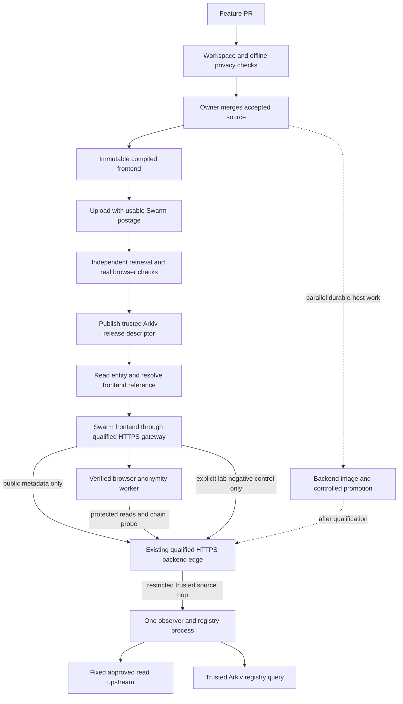

# Swarm frontend, Arkiv integration and CI/CD proposal

Planning date: 7 November 2026, Asia/Kolkata. Tracking: [issue #93](https://github.com/Dijo-404/monolith/issues/93).

The owner selected **Ethereum Swarm as the primary frontend host to pursue the Arkiv + Swarm bonus**. The target is a Swarm-hosted static dashboard, useful Arkiv release discovery, a separate observer/registry backend, and GitHub Actions for checks and releases. Docker Compose remains the eventual single-host backend target; Docker Swarm is a different product and is unnecessary for the first backend instance.

This selection supersedes the earlier Pages-primary recommendation. Prioritize a working Swarm frontend with real Arkiv linkage using the existing accepted backend, whose actual availability must be rechecked. Full backend migration is a separate workstream and must not unnecessarily delay the Swarm evidence path. The hosting budget remains **₹0**: provided postage/upload access and an available backend are operational gates, not established resources. Durable backend capacity remains to be qualified.

This document plans future work. It changes no runtime or workflow configuration and records no new deployment, paid service, source-publication decision, live privacy result or sponsor eligibility. Existing release owners and evidence gates remain in force under [CONTRIBUTING.md](../CONTRIBUTING.md).

## Existing system and gaps

The initial inventory was inspected at accepted source `014c5af4b06a565d1179b9d40ca32717381a4d28`; the planning branch subsequently integrated main through `b020f8d7da3af6dde8b8ef21a385a26960b84263`. Recheck the selected release commit before implementation; later UI/release changes may alter the artifact. [Architecture](architecture.md), [contracts](contracts.md), [deployment preparation](deployment.md) and [observer deployment](observer-deployment.md) remain the governing boundaries.

| Component | Existing implementation | Deployment consequence |
| --- | --- | --- |
| Dashboard | React/Vite static build; only `MONOLITH_PUBLIC_OBSERVER_URL` is exposed through an explicit allowlist | Needs an HTTPS backend origin at build time; upload compiled assets and notices, not the private source archive |
| Browser transport | Verified Nym worker, separate worker-host HTML, protected chain-ID probe, fail-closed reads | A successful static upload cannot establish worker execution or privacy |
| Observer and registry | Fastify plus public registry reader; fixed operator-approved read targets | Needs Node compute and server-only Arkiv access; static storage cannot run it |
| Public lab composition | `createPublicDemo()` with strict public edge, run-query bridge and selected registry credential | Generic `pnpm start:observer` is not a replacement for this composition |
| Public source adapter | PROXYv2 through a host-pinned SSH connection into loopback; caller forwarding assertions discarded | Replacing the tunnel requires a reviewed source adapter and real paired-source observations |
| Lab state | Five-minute in-memory runs and source baselines; process-local allocation/rate limits | One replica initially; restarts invalidate active runs |
| CI | Workspace checks and offline browser privacy regressions | Deployment, image publication and production promotion workflows still need implementation |
| Packaging | Clean-commit snapshot, frozen installation, notices/provenance, hosted-byte and browser checks | Reuse these controls for another host; they do not grant a new platform an automatic exception |

Existing tools are pinned to Node **24.22.2** and pnpm **12.18.0**. This inventory does not assert present availability of any historical public hostname.

## Platform decision

| Option | Suitable role | Decision and constraint |
| --- | --- | --- |
| Ethereum Swarm | Selected primary frontend | Upload the compiled directory through Bee with a usable postage batch. Qualify the HTTPS gateway, worker behavior and independent retrieval; link this release through Arkiv. [Website hosting](https://docs.ethswarm.org/docs/develop/host-your-website/) |
| Existing Sites publication | Current frontend | Keep it serving while the candidate is evaluated. Existing hosting-specific HTML/frame exceptions apply only to their exact reviewed templates. |
| Cloudflare Pages | Unselected fallback | CI upload and header controls remain useful alternatives if Swarm is blocked, but do not complete the chosen Swarm path. Changing the primary host again needs an owner scope decision. [Direct upload](https://developers.cloudflare.com/pages/how-to/use-direct-upload-with-continuous-integration/), [headers](https://developers.cloudflare.com/pages/configuration/headers/), [free-plan limits](https://developers.cloudflare.com/pages/platform/limits/) |
| IPFS with pinning | Optional additional mirror | Not a substitute for the selected Swarm integration. Retention needs pinning and a usable dedicated/subdomain gateway. [CI publishing](https://docs.ipfs.tech/how-to/websites-on-ipfs/deploy-github-action/), [gateway isolation](https://docs.ipfs.tech/concepts/ipfs-gateway/) |
| Operator host with Docker Compose | Initial backend | Preferred architecture: one process and controlled ingress. Hardware, public reachability, TLS and continuity must actually be available within budget. |
| Docker Swarm | Later backend orchestration | Schedules services on machines we supply; it is separate from Ethereum Swarm. Adds little for one stateful process. Its stack format needs separate validation from modern Compose. [Stack deployment](https://docs.docker.com/engine/swarm/stack-deploy/) |
| Render Free | Backend experiment | Idle spin-down after 15 minutes, restarts and usage limits make it a demonstration candidate, not the durable default. Source provenance remains unqualified. [Free-service limits](https://render.com/docs/free) |
| Akash | Decentralized backend alternative | Runs containers under provider leases with funded escrow. Evaluate only after funding and source-edge qualification; a lease can end when funds run out. [Deployment lifecycle](https://akash.network/docs/learn/core-concepts/deployments/) |

Swarm distributes the public application files; the backend and HTTPS gateway remain separate availability/trust dependencies. Do not treat decentralized storage as complete application hosting.

Under ₹0, first establish whether an already-provided batch and Bee/upload service are usable; no sponsored access is currently confirmed. Do not activate billing, buy a domain, purchase postage or open a compute lease. Keep the existing backend for the first Swarm candidate if its current source-bound checks pass; describe its continuity limits honestly. If either resource is unavailable, record that blocker without silently switching frontend providers. Check CI/registry allowances as well as hosting allowances before enabling publication.

## Arkiv + Swarm bonus evidence

The [official from-scratch bonus](https://ethglobal.com/events/mumbai/prizes/arkiv) is selected alongside Mirror, Build on Arkiv or Node tooling and can supplement a track prize. Meaningful use of both systems is required. Primary frontend hosting is the owner's choice, not a separate published condition.

The required `/arkiv/swarm.md` must identify:

- Content on each system and the Arkiv field containing its Swarm reference/feed.
- A real entity key, linked reference and openable URL.
- Postage batch ID, buying wallet or batch provider, and uploading Bee/service.
- Repository upload/read files, prerequisites, reproduction commands and expected results.
- The demo-video moment and integration difficulties.

Encrypted references carry keys; protect them before publishing to public Arkiv. No free postage entitlement is stated. Purchase transaction evidence is useful additional provenance, not an explicitly listed condition. These requirements remain unfulfilled until actual observations and artifacts exist; hosting alone is insufficient.

### Proposed Monolith integration

Use a separate public release-descriptor entity with a proposed `swarmReference` field for the exact frontend collection hash, plus source commit, artifact-inventory digest, publication time and bounded freshness. This is a new, separately coordinated entity design, not an extension of the frozen RPC endpoint DTO. Keep current endpoint records, trust pins and accepted importer evidence intact. Schema tags do not authenticate a release: pin the authorized publisher and validate reference shape, provenance and expiry before use.

Size both entity lifetime and postage retention for the intended judging/reproduction window and verify their actual remaining time, including any block-based expiry. A newly published but nearly expired descriptor is not a usable handoff. Refresh/republication is an explicit operator write with fresh evidence, never permission to accept expired data.

Make release discovery useful: read that entity to resolve the Swarm frontend, retrieve its public artifact inventory/notices and verify the selected files. Supply an independent repo-local reader for the same entity-to-content path. Any new UI metadata route needs explicit API/public-edge ownership and contract review; do not admit it implicitly. Store only reviewed public release data, never source observations, wallet queries or keys. Keep importer/publisher signing material out of the observer runtime and frontend.

Publish the release descriptor only after uploading and independently checking the exact frontend. The returned reference belongs in an external receipt/entity; do not rebuild the uploaded bundle just to insert its own hash. Retain the actual write/query identifiers and observed reads, with no fabricated sample key or mock presented as proof. A later publisher or video/submission step has its own normal authorization and evidence boundary.

## Target topology



The ingress is the backend's observation boundary. It must preserve the difference between the direct control and worker egress. The frontend gateway must not become an unexamined API proxy that collapses both paths into one source. Ordinary page delivery, public metadata contact, release discovery and worker bootstrap remain disclosed contacts; RPC payloads remain visible to their destination.

## Backend portability requirements

Create a small portable public-lab entrypoint using the existing application/composition boundaries. Preserve the reviewed public route/query bridge, public-run opt-in, fixed chain/upstream bindings, deadlines, body limits, non-credentialed worker-compatible CORS and registry policy. Give the public/private listeners deliberate bind addresses and ports, support shutdown signals, and remove reliance on an SSH child for the new target. Keep the old launcher as a separate deployment adapter.

For ingress, prefer a controlled TLS edge with a restricted, authenticated or locally isolated PROXYv2 connection into the existing edge. A reviewed HTTP source adapter is an alternative only when the actual trusted peer and overwrite behavior can be verified. Never expose a PROXY listener or private HTTP hop to untrusted clients. Strip caller forwarding headers before deriving source metadata from the trusted connection. Unverified topology returns `unknown` and fails the paired-source acceptance gate.

The current PROXY edge accepts one HTTP/1.1 request per connection and rejects transfer encoding, Expect, upgrades and CONNECT. A compatible ingress must disable upstream connection reuse and buffer/normalize external chunked requests within the existing size/deadline bounds before forwarding. Qualify these framing rules as well as source metadata; ordinary proxy defaults are not sufficient.

Docker's routing mesh is another hop to examine. Host-mode publication can bypass the mesh; it is not proof of client-source preservation. Demonstrate the actual path and spoofed-header rejection. For the single-host target, prefer local ingress/backend communication with no public private-hop port. [Docker ingress documentation](https://docs.docker.com/engine/swarm/ingress).

Build the backend image in stages with a digest-pinned base and frozen workspace dependencies. Include the compiled public workspace exports required at runtime, not only `apps/observer/dist`. Run as a non-root user, restrict writable paths, bound memory/CPU and configure restart behavior. Select initial resource limits from measured startup and synthetic load, rather than asserting an untested minimum. Exclude `.env`, SSH keys, publisher wallets and build credentials from the context, layers and logs. Label the source SHA; publish and deploy by image digest.

The portable composition must explicitly wire the selected server-only Arkiv credential. The generic registry startup path currently omits it. Preserve fixed Rabdi URL/header-only authentication and fail closed when an explicitly selected credential is missing or invalid. The launcher's existing `readServerAccessKey()` helper requires an absolute regular non-symlink file with restrictive permissions and one literal `ARKIV_ACCESS_KEY` assignment; it does not currently validate UID ownership. A container secret must satisfy that format/mode and be readable by the intended non-root process, or use a separately reviewed adapter. Docker Swarm secrets support service-scoped mounts; their defaults must not be assumed compatible with this helper. [Docker secrets](https://docs.docker.com/engine/swarm/secrets/).

Keep one observer process. Do not enable replica autoscaling or start-first overlapping replicas while source baselines, runs and global limits are process-local. Initially use a documented brief maintenance window: stop admissions through a reviewed mechanism or take the service offline, then replace the process. A timer alone cannot drain a service that still allocates new runs. Invalidated runs need fresh allocation. Shared state or affinity with consistent global limits is a separate design before horizontal scaling; no new database is required for the first deployment.

`GET /api/health` currently indicates configured process state; it does not prove Arkiv freshness or worker success. Keep liveness cheap. Add a separate bounded readiness check for configuration and current trusted metadata, with explicit degraded/blocked output. Routine uptime checks should not allocate runs or generate target RPC traffic. Registry entity expiry and current block checks remain authoritative; the lab's manifest timing policy is not permission to extend entity lifetimes. Any importer renewal remains a separately authorized operator write job.

## Primary Swarm frontend compatibility

Select the actual Swarm gateway before choosing the build layout. **An isolated application origin is a promotion gate**, regardless of path layout. A qualified dedicated/subdomain origin may map the release at `/`; a dedicated gateway restricted to this application may retain `/bzz/<reference>/` if isolation and path handling are verified. Do not promote on a shared multi-tenant origin merely because its files load. Today's Vite build has no base override, and `createProductionLiveLab()` resolves `/assets/worker-host.html` from the origin root. A path deployment therefore needs base-aware asset and worker-host resolution. A relative Vite base alone does not fix the explicit worker URL or origin exposure.

Verify the distinct worker HTML and referenced module, all executable MIME types, HTTPS, sandbox/null-origin CORS, bootstrap, blob/WASM/WebRTC behavior and actual installed SDK execution. Set only headers justified by the runtime: repository inspection does not establish a blanket COOP/COEP requirement. Test any CSP/isolation policy against the real worker and avoid broadening it until observed behavior requires it. Do not return the SPA shell for missing worker documents or scripts. Unknown injected hosting scripts/frames fail review; the Sites exception is not a general CDN allowlist.

Serve content-hashed assets with immutable caching. Revalidate the stable HTML/pointer so browsers discover releases. Preserve dependency/font notices and the exact public build configuration. Swarm/IPFS publication exposes the selected compiled files publicly and can outlive a pointer rollback; upload no source archive, credentials, raw source observations, private wallet data or unreviewed evidence bundle.

Gateway response headers are deployment behavior, not a capability supplied automatically by a directory manifest. Bind gateway configuration separately from public assets and verify effective headers. Keep the public inventory exact; add no broad missing-file, redirect or injected-content exception to the verifier.

For each Swarm release, measure the actual artifact and retained-release count, then size postage capacity and redundancy deliberately. Check batch usability, remaining TTL and utilization before upload; abort instead of buying or topping up automatically. Await synchronization and retrieve the candidate through an independent node/gateway before declaring it available. Immutable batches do not imply permanent retention after postage expires. [Postage capacity and lifetime](https://docs.ethswarm.org/docs/develop/tools-and-features/buy-a-stamp-batch/), [redundancy](https://docs.ethswarm.org/docs/develop/tools-and-features/erasure-coding/).

Initially expose the immutable Swarm release URL and resolve its descriptor through Arkiv. A stable feed is optional: the first demonstrable release does not require purchasing ENS or a domain. Any feed/naming update is a later explicit publication step, with publisher credentials isolated from PR jobs. If an IPFS mirror is added, it needs separate pin confirmation and retrieval. Do not claim bonus completion from this plan or packaging alone.

## CI/CD design

Use the existing checks as the first gate. Add release jobs rather than replacing privacy regressions with image health checks.

| Stage | Trigger and inputs | Required result |
| --- | --- | --- |
| PR validation | Pull request; no deployment credentials | Frozen install, `pnpm check`, existing static and browser privacy regressions; focused deployment-boundary tests when deployment code changes |
| Release packaging | Exact accepted `main` SHA with required checks for that same SHA | Frontend archive per public configuration, notices, file hashes and provenance; backend image/scan/SBOM when its separate delivery path is ready |
| Swarm candidate upload | Trusted release workflow; provided batch/service and quota checks satisfied | Immutable website reference, batch/upload receipt and HTTPS candidate URL; no stable pointer or release-entity publication yet |
| Candidate acceptance | Exact frontend reference and known backend source/runtime | Independent retrieval, served-byte/MIME checks, real worker and leak/repair workflow; retain failed attempts honestly |
| Release publication | Owner selects a concrete verified candidate | Publish its reviewed public release descriptor; independently query it and resolve/retrieve that frontend. Later backend-image promotion requires its own qualification |
| Post-publication verification | Same source/config/reference and actual release record | Bounded health plus real deployed acceptance and entity-to-content verification; retain prior compatible identities and receipts |
| Rollback | Failed promotion/verification or owner-selected prior release | Frontend-only: restore a compatible prior Swarm discovery reference and verify, without replacing the existing backend. Restore image/config and invalidate runs only when a backend deployment is also being rolled back |

**Build frontend artifacts once per public configuration.** Staging and production observer origins differ, so their hashes and Swarm references differ even at the same source SHA. Never relabel a staging bundle as production. Build the production candidate with the intended currently qualified backend origin, bind its hashes, upload it and verify that exact reference before publishing release discovery. An immutable candidate can be tried directly without advancing a stable pointer. After backend-image work is ready, build it once per source revision and promote its digest; require backward-compatible API behavior or a maintenance window.

A staging backend needs isolated run state and configuration. Provision no permanent second host under the ₹0 assumption: use bounded temporary staging where capacity permits. For the immediate frontend-only path, a coordinated production-config candidate may use the existing backend, with distinct fresh synthetic runs and complete request accounting. This is candidate verification against the existing service, not a claim of an isolated staging environment. Backend replacement remains separately controlled.

The proposed release manifest records source SHA, tool versions, lockfile/build-policy hashes, public observer origin, static inventory/hashes, notices, Swarm collection reference, gateway URL, batch/service provenance, backend runtime/source identity, Arkiv release-record identity and check/evidence references. Add the backend image digest when that path exists; an observed current process cannot be relabeled as an image. Record a non-secret credential version if needed, never the secret or its hash. A receipt adds actual publication time, resulting pointer and verification results. These deployment artifacts do not replace shared report contracts or historical evidence.

Pin actions and publishing tools, use read-only permissions by default and grant publication only to its job. Publish images privately unless the owner chooses otherwise; compiled-site publication does not authorize source or registry visibility changes. Separate Swarm upload access, Arkiv publishing identity and backend deployment access. PR code must never execute with these credentials; avoid privileged workflows consuming arbitrary PR artifacts. Use OIDC where supported, otherwise narrowly scoped credentials. Arkiv writes and storage-capacity changes are bounded operator actions, not effects of ordinary PR checks. [GitHub secure workflow guidance](https://docs.github.com/en/actions/reference/security/secure-use).

Keep build/PR runners off the production host. Promote through an owner-controlled command or a restricted deployment channel; do not give an untrusted workflow a production shell or Docker socket.

Use per-environment deployment concurrency with cancellation disabled during promotion/rollback. A stale run must not overwrite a newer release pointer. Keep build cancellation separate from deployment state. If using separate workflows, validate the originating workflow, exact SHA, successful required checks and accepted-main ancestry before consuming an artifact.

Check account support before relying on GitHub environment approvals: required reviewers are restricted by repository visibility and plan, and private environment features also depend on plan. If enforceable protection is unavailable, leave production credentials outside CI and have the owner promote the concrete verified manifest locally; an environment name or workflow-dispatch button alone is not an approval boundary. Automatic staging remains possible with isolated staging credentials. Agents continue to open PRs; the owner merges them. [GitHub environments and restrictions](https://docs.github.com/en/actions/reference/workflows-and-actions/deployments-and-environments).

The immediate deliverable is reproducible Swarm upload/read and Arkiv release discovery with observed browser evidence. CI can automate the verified steps once scoped publication credentials, provided storage and owner policy exist. Durable backend CD can follow independently. Fully automatic production publication is a later owner policy choice.

## Verification and rollback criteria

These commands already exist; they are future execution requirements here, not checks run by this planning change:

```sh
pnpm install --frozen-lockfile
pnpm check
pnpm exec tsx scripts/check-rpc-egress.ts
pnpm exec vitest run tests/privacy/egress/policy.test.mjs
pnpm exec tsc -p tests/privacy/egress/tsconfig.json
pnpm exec vitest run apps/observer/test/public-demo
pnpm exec vitest run --config deploy/observer/vitest.config.mjs
```

Reuse [static packaging and deployed verification](../scripts/deploy/README.md), including `prepare-static.mjs`, `verify-static.mjs` and `browser-deployed.mjs`. Current static and live runners assume an HTTPS origin; a `/bzz/<reference>/` target requires reviewed application and verifier/runner changes, or an actually qualified isolated root origin. Use the live workflow documented in [lab UI acceptance](../tests/e2e/lab-ui/README.md) with fresh output, rather than copying a historical result.

The deployment acceptance matrix must include:

- Isolated application origin plus exact served frontend bytes, notices and public configuration; distinct worker host/module; desktop/mobile and WebGL fallback; rejected unexpected hosting additions.
- Independent Swarm retrieval and trusted release-descriptor resolution select the same exact files; rejected untrusted/expired descriptors never become routing authority. Missing postage/access, failed sync/retrieval or reference mismatch stops publication.
- Real verified-worker initialization and protected chain probe, useful reads, direct control, deliberate leak failure, repaired success and full independent request inventory. Preserve bootstrap and payload-visibility disclosures.
- Worker outage produces blocked reads and zero ordinary fallback. Wrong-chain, expired/untrusted registry data and unavailable metadata never enable routing.
- Forged forwarding headers/PROXY frames, direct private-hop access, arbitrary endpoint URLs, write RPC methods, oversized bodies, credentials and disallowed routes remain rejected or yield unknown source as appropriate.
- Process restart, expired run, allocation/rate limits, bad secret selection/mode and shutdown behavior remain bounded; no raw IP/request-body/key data appears in operator-controlled ingress, application or CI logs. Disclose provider logging/retention limits separately.
- Static-byte mismatch and failed browser acceptance cannot advance discovery. Exercise restoration of the previous compatible frontend reference without changing the existing backend, plus rejection of stale promotion. Add failed image-readiness and image/config restoration checks when the backend-image path is implemented.

Keep at least the prior accepted frontend and backend identities, configuration revision and retrievable artifacts. Frontend-only rollback can publish a new authorized discovery descriptor pointing to the prior still-valid content; preserve the original record and event history. A rollback does not restore old in-memory runs, make expired Arkiv entities valid or erase published content. Start a fresh run and verify current trust/freshness after rollback. If the prior release no longer passes those gates, keep reads blocked while repairing the service.

Operate with sanitized aggregate counters, bounded health/TLS checks and alerts for process failure, registry unavailability, trust/expiry failures, storage/pinning or postage exhaustion and quota limits. Do not add browser analytics to measure uptime. Agree alert ownership and retention before enabling notifications; no external messaging is configured by this plan. Define an availability objective only after a measured observation period on the selected host.

## Ordered implementation work

The rows below are proposed work packages, not claimed or ready MN tasks. Register and coordinate final issue scopes before implementation. The Swarm path stays separate from existing core-release ownership. Start from an explicitly selected clean accepted UI/backend source and recheck the relevant MN-023/MN-025/MN-014/MN-016 gates and current availability; a coordinated candidate experiment does not accept unfinished MN-017 or any dependency. A final release/submission still needs its ordinary accepted evidence. Full durable backend migration is not a prerequisite for Swarm qualification against an available accepted backend.

| Order | Proposed scope and files | Dependency and acceptance |
| --- | --- | --- |
| 1. Qualify Swarm access and current backend | New bounded preflight/report; isolated environment and selected source identities | Coordinate static/backend owners. Establish provided batch/service, TTL/capacity, gateway origin behavior and actual backend availability. Missing resources are explicit blockers; no purchase or backend replacement is implied. |
| 2. Swarm frontend upload and read | Proposed `deploy/swarm/`, scoped `scripts/deploy/` adapters/tests; dashboard base/worker URL and runner paths only if required | Coordinate dashboard/transport pins and deployment owner. Build once, upload exact output, retrieve independently and pass real worker/live privacy workflow from the Swarm URL. Preserve current publication until acceptance. |
| 3. Useful Arkiv release discovery | New release-descriptor schema/publisher/reader paths agreed with registry owner; scoped public UI/API integration if needed | After the exact frontend reference exists. Freeze public fields and publisher policy, publish/query a real descriptor, resolve/retrieve the selected release and reject forged/expired/mismatched data. No silent endpoint-contract expansion or old-record rewrite. |
| 4. Reproduction and submission evidence | Proposed `arkiv/swarm.md`, upload/read runbook and redacted evidence; demo/README scope coordinated separately | After actual upload/read and deployed checks. Record observed identifiers/results and remaining limits. Public-source disclosure and final partner/video submission remain owner decisions; writing a document is not submission or eligibility acceptance. |
| 5. Swarm release CI | Proposed `.github/workflows/release.yml`, manifest tooling/schema and focused `tests/deploy/` cases | After reproducible frontend/discovery acceptance; coordinate CI ownership. Exact-SHA/config checks, provided-capacity preflight, guarded upload/publication, failed-promotion tests, concurrency and recoverable prior reference. No unowned root dependency changes. |
| Parallel durable backend path | Qualified host preflight, portable observer entrypoint/tests, proposed Dockerfile/Compose/ingress/runbook under coordinated backend/deploy scope | Proceed independently with existing backend owner. Keep one process, private source hop, explicit secrets and bounded shutdown. Prove image/source identity and rollback before adding backend CD. Docker Swarm remains optional later. |

Steps 1–4 form the immediate bonus-oriented path; the existing backend can serve it if its current checks pass. With usable supplied postage, a compatible gateway and current accepted sources, budget roughly six to twelve focused engineering hours for upload/read compatibility and release discovery, then evidence/video capture. Gateway isolation or worker incompatibility can extend that range. This is not a promise to meet today's event cutoff. Full backend migration and generalized CI/CD remain separate, roughly two to four working days depending on host qualification and review.

The next implementation step is a bounded Swarm-access/gateway preflight coordinated with the current deployment owner, while rechecking the existing backend. Confirm supplied postage and a safe serving origin before making writes; then deliver the real release-discovery path and its evidence. Source publication, postage spending and external submission are not authorized by this planning revision.
