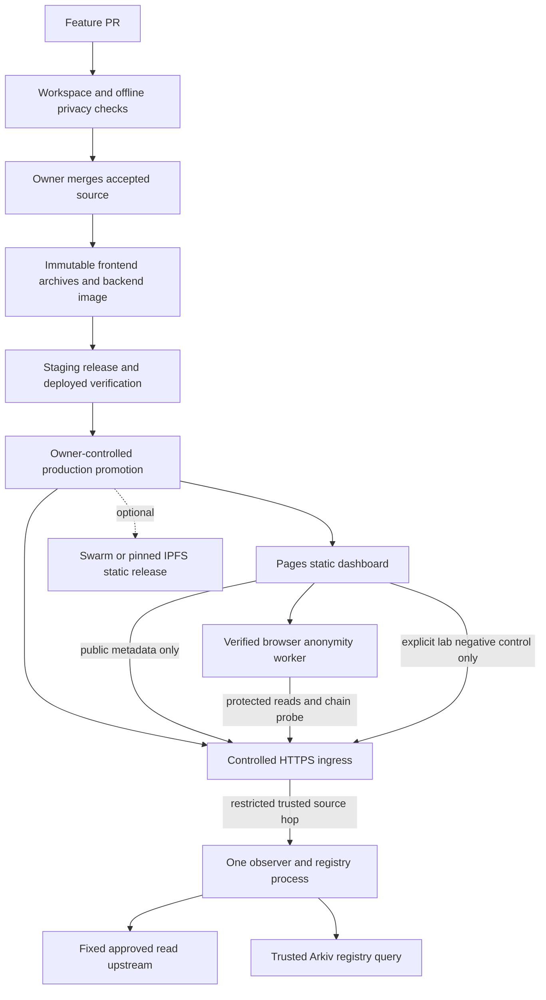

# Deployment and CI/CD proposal

Planning date: 7 November 2026, Asia/Kolkata. Tracking: [issue #93](https://github.com/Dijo-404/monolith/issues/93).

The recommended target is **Cloudflare Pages for the static dashboard, one containerized observer/registry backend on an operator-controlled host, and GitHub Actions for checks and release artifacts**. Use Docker Compose for the initial single-host deployment. Treat Ethereum Swarm or IPFS as optional frontend mirrors after browser compatibility and storage funding are established. Docker Swarm becomes useful only if operating several hosts becomes necessary.

This is an engineering recommendation based on the repository and the platform documentation linked below. The owner requested the most suitable platform, without a preference between the two meanings of Swarm. Cost, reliable source observations, browser compatibility and operating effort determine this choice. The existing hosting budget remains **₹0**. An available, qualified free host or already-owned always-on machine is still needed for a durable backend; this proposal does not establish that either is available.

This document plans future work. It changes no runtime or workflow configuration and records no new deployment, paid service, source-publication decision, live privacy result or sponsor eligibility. Existing release owners and evidence gates remain in force under [CONTRIBUTING.md](../CONTRIBUTING.md).

## Existing system and gaps

The code inventory below was inspected at accepted source `014c5af4b06a565d1179b9d40ca32717381a4d28`. Recheck the final accepted release commit before implementation; pending UI, walkthrough and release changes may alter the artifact. [Architecture](architecture.md), [contracts](contracts.md), [deployment preparation](deployment.md) and [observer deployment](observer-deployment.md) remain the governing boundaries.

| Component | Existing implementation | Deployment consequence |
| --- | --- | --- |
| Dashboard | React/Vite static build; only `MONOLITH_PUBLIC_OBSERVER_URL` is exposed through an explicit allowlist | Needs an HTTPS backend origin at build time; upload compiled assets and notices, not the private source archive |
| Browser transport | Verified Nym worker, separate worker-host HTML, protected chain-ID probe, fail-closed reads | A successful static upload cannot establish worker execution or privacy |
| Observer and registry | Fastify plus public registry reader; fixed operator-approved read targets | Needs Node compute and server-only Arkiv access; static storage cannot run it |
| Public lab composition | `createPublicDemo()` with strict public edge, run-query bridge and selected registry credential | Generic `pnpm start:observer` is not a replacement for this composition |
| Public source adapter | PROXYv2 through a host-pinned SSH connection into loopback; caller forwarding assertions discarded | Replacing the tunnel requires a reviewed source adapter and real paired-source observations |
| Lab state | Five-minute in-memory runs and source baselines; process-local allocation/rate limits | One replica initially; restarts invalidate active runs |
| CI | Workspace checks and offline browser privacy regressions | Deployment, image publication and production promotion workflows still need implementation |
| Packaging | Clean-commit snapshot, frozen installation, notices/provenance, hosted-byte and browser checks | Reuse these controls for another host; they do not grant a new platform an automatic exception |

Existing tools are pinned to Node **24.22.2** and pnpm **12.18.0**. This inventory does not assert present availability of any historical public hostname.

## Platform decision

| Option | Suitable role | Decision and constraint |
| --- | --- | --- |
| Cloudflare Pages | Primary static dashboard | Preferred migration candidate: supports CI direct upload and response-header configuration. Qualify its actual worker behavior and account limits before promotion. [Direct upload](https://developers.cloudflare.com/pages/how-to/use-direct-upload-with-continuous-integration/), [headers](https://developers.cloudflare.com/pages/configuration/headers/), [free-plan limits](https://developers.cloudflare.com/pages/platform/limits/) |
| Existing Sites publication | Current frontend | Keep it serving while the candidate is evaluated. Existing hosting-specific HTML/frame exceptions apply only to their exact reviewed templates. |
| Ethereum Swarm | Decentralized static mirror | Bee plus a valid postage batch uploads a directory manifest; a feed can provide a stable pointer. Does not supply the Node backend. Storage requires funded postage or a provided batch. [Website hosting](https://docs.ethswarm.org/docs/develop/host-your-website/) |
| IPFS with pinning | Alternative static mirror | Content-addressed artifacts fit releases; retention needs pinning and a usable gateway. Use a dedicated or subdomain origin for the web app. [CI publishing](https://docs.ipfs.tech/how-to/websites-on-ipfs/deploy-github-action/), [gateway isolation](https://docs.ipfs.tech/concepts/ipfs-gateway/) |
| Operator host with Docker Compose | Initial backend | Preferred architecture: one process and controlled ingress. Hardware, public reachability, TLS and continuity must actually be available within budget. |
| Docker Swarm | Later backend orchestration | Schedules services on machines we supply; it is separate from Ethereum Swarm. Adds little for one stateful process. Its stack format needs separate validation from modern Compose. [Stack deployment](https://docs.docker.com/engine/swarm/stack-deploy/) |
| Render Free | Backend experiment | Idle spin-down after 15 minutes, restarts and usage limits make it a demonstration candidate, not the durable default. Source provenance remains unqualified. [Free-service limits](https://render.com/docs/free) |
| Akash | Decentralized backend alternative | Runs containers under provider leases with funded escrow. Evaluate only after funding and source-edge qualification; a lease can end when funds run out. [Deployment lifecycle](https://akash.network/docs/learn/core-concepts/deployments/) |

Swarm/IPFS add distribution and verifiable content references, but the backend and gateway remain separate availability/trust dependencies. Choose them for that benefit, rather than treating decentralized storage as complete application hosting.

Under ₹0, first automate build artifacts and qualify the host already available to the operator. Do not activate billing, buy a domain, purchase postage or open a compute lease. If no suitable free backend exists, record that operational blocker and retain an explicitly temporary demonstration service. Do not promise permanent uptime from a free tunnel or sleeping service. Check CI/registry allowances as well as hosting allowances before enabling publication.

## Target topology



The ingress is the backend's observation boundary. It must preserve the difference between the direct control and worker egress. The frontend CDN must not become an unexamined API proxy that collapses both paths into one source. Ordinary page delivery, public metadata contact and worker bootstrap remain disclosed contacts; RPC payloads remain visible to their destination.

## Backend portability requirements

Create a small portable public-lab entrypoint using the existing application/composition boundaries. Preserve the reviewed public route/query bridge, public-run opt-in, fixed chain/upstream bindings, deadlines, body limits, non-credentialed worker-compatible CORS and registry policy. Give the public/private listeners deliberate bind addresses and ports, support shutdown signals, and remove reliance on an SSH child for the new target. Keep the old launcher as a separate deployment adapter.

For ingress, prefer a controlled TLS edge with a restricted, authenticated or locally isolated PROXYv2 connection into the existing edge. A reviewed HTTP source adapter is an alternative only when the actual trusted peer and overwrite behavior can be verified. Never expose a PROXY listener or private HTTP hop to untrusted clients. Strip caller forwarding headers before deriving source metadata from the trusted connection. Unverified topology returns `unknown` and fails the paired-source acceptance gate.

The current PROXY edge accepts one HTTP/1.1 request per connection and rejects transfer encoding, Expect, upgrades and CONNECT. A compatible ingress must disable upstream connection reuse and buffer/normalize external chunked requests within the existing size/deadline bounds before forwarding. Qualify these framing rules as well as source metadata; ordinary proxy defaults are not sufficient.

Docker's routing mesh is another hop to examine. Host-mode publication can bypass the mesh; it is not proof of client-source preservation. Demonstrate the actual path and spoofed-header rejection. For the single-host target, prefer local ingress/backend communication with no public private-hop port. [Docker ingress documentation](https://docs.docker.com/engine/swarm/ingress).

Build the backend image in stages with a digest-pinned base and frozen workspace dependencies. Include the compiled public workspace exports required at runtime, not only `apps/observer/dist`. Run as a non-root user, restrict writable paths, bound memory/CPU and configure restart behavior. Select initial resource limits from measured startup and synthetic load, rather than asserting an untested minimum. Exclude `.env`, SSH keys, publisher wallets and build credentials from the context, layers and logs. Label the source SHA; publish and deploy by image digest.

The portable composition must explicitly wire the selected server-only Arkiv credential. The generic registry startup path currently omits it. Preserve fixed Rabdi URL/header-only authentication and fail closed when an explicitly selected credential is missing or invalid. The launcher's existing `readServerAccessKey()` helper requires an absolute regular non-symlink file with restrictive permissions and one literal `ARKIV_ACCESS_KEY` assignment; it does not currently validate UID ownership. A container secret must satisfy that format/mode and be readable by the intended non-root process, or use a separately reviewed adapter. Docker Swarm secrets support service-scoped mounts; their defaults must not be assumed compatible with this helper. [Docker secrets](https://docs.docker.com/engine/swarm/secrets/).

Keep one observer process. Do not enable replica autoscaling or start-first overlapping replicas while source baselines, runs and global limits are process-local. Initially use a documented brief maintenance window: stop admissions through a reviewed mechanism or take the service offline, then replace the process. A timer alone cannot drain a service that still allocates new runs. Invalidated runs need fresh allocation. Shared state or affinity with consistent global limits is a separate design before horizontal scaling; no new database is required for the first deployment.

`GET /api/health` currently indicates configured process state; it does not prove Arkiv freshness or worker success. Keep liveness cheap. Add a separate bounded readiness check for configuration and current trusted metadata, with explicit degraded/blocked output. Routine uptime checks should not allocate runs or generate target RPC traffic. Registry entity expiry and current block checks remain authoritative; the lab's manifest timing policy is not permission to extend entity lifetimes. Any importer renewal remains a separately authorized operator write job.

## Frontend compatibility and decentralized mirrors

Pages exposes a root website, which matches the current build more closely. A gateway path such as `/bzz/<reference>/` or `/ipfs/<cid>/` does not: Vite currently has no base override, and `createProductionLiveLab()` resolves `/assets/worker-host.html` from the origin root. Either select a dedicated origin that maps the release at `/`, or implement and test base-aware asset and worker-host resolution. A relative Vite base alone does not fix the explicit worker URL.

Verify the distinct worker HTML and referenced module, all executable MIME types, HTTPS, sandbox/null-origin CORS, bootstrap, blob/WASM/WebRTC behavior and actual installed SDK execution. Set only headers justified by the runtime: repository inspection does not establish a blanket COOP/COEP requirement. Test any CSP/isolation policy against the real worker and avoid broadening it until observed behavior requires it. Do not return the SPA shell for missing worker documents or scripts. Unknown injected hosting scripts/frames fail review; the Sites exception is not a general CDN allowlist.

Serve content-hashed assets with immutable caching. Revalidate the stable HTML/pointer so browsers discover releases. Preserve dependency/font notices and the exact public build configuration. Swarm/IPFS publication exposes the selected compiled files publicly and can outlive a pointer rollback; upload no source archive, credentials, raw source observations, private wallet data or unreviewed evidence bundle.

Pages consumes deployment control files such as `_headers` without serving them as public assets. Bind those files in a separate control-file inventory and verify their effective behavior. Keep the public asset inventory exact; do not add a general missing-file exception to the hosted-byte verifier.

For a Swarm mirror, measure the actual artifact and retained-release count, then size postage capacity and redundancy deliberately. Check batch usability, remaining TTL and utilization before upload; abort instead of buying or topping up automatically. Await synchronization and retrieve the candidate through an independent node/gateway before declaring it available. Immutable batches do not imply permanent retention after postage expires. [Postage capacity and lifetime](https://docs.ethswarm.org/docs/develop/tools-and-features/buy-a-stamp-batch/), [redundancy](https://docs.ethswarm.org/docs/develop/tools-and-features/erasure-coding/).

Initially expose immutable release URLs. A Swarm feed, DNSLink or ENS update is a later explicit publication step, with publisher credentials isolated from PR jobs. An IPFS CID needs actual pin confirmation and independent retrieval; constructing a CID alone does not establish availability. Do not claim the Arkiv Swarm bonus from this plan or a packaging experiment.

## CI/CD design

Use the existing checks as the first gate. Add release jobs rather than replacing privacy regressions with image health checks.

| Stage | Trigger and inputs | Required result |
| --- | --- | --- |
| PR validation | Pull request; no deployment credentials | Frozen install, `pnpm check`, existing static and browser privacy regressions; focused deployment-boundary tests when deployment code changes |
| Release packaging | Exact accepted `main` SHA with required checks for that same SHA | Backend image, frontend archive for each public configuration, notices, file hashes, image scan/SBOM and source/config provenance |
| Candidate publication | Trusted release workflow; budget and provider configuration satisfied | Image digest and staging frontend URL; optional immutable hash/CID; no production pointer change |
| Staging acceptance | Exact candidate backend and frontend identities | Served-byte/MIME checks, edge spoof/route limits, real worker and complete leak/repair workflow; failures retain blocked evidence |
| Production promotion | Owner selects a concrete reviewed release | Deploy the verified image digest, verify the production frontend candidate, then update the stable frontend/pointer |
| Post-deploy verification | Same release manifest and expected configuration | Bounded health plus real deployed acceptance; retain previous compatible release and receipts |
| Rollback | Failed promotion/verification or owner-selected prior release | Restore compatible image/config and frontend reference, verify, invalidate old runs and record the incident |

Build the backend image once for a source revision and promote its digest. **Build frontend artifacts once per public configuration.** Staging and production observer origins differ, so their frontend hashes differ even at the same source SHA. Never relabel the staging bundle as production. Build a production candidate with the intended stable production API origin, bind its separate hashes, then verify that exact candidate after the production backend is available and before advancing the public frontend pointer. Require backward-compatible API behavior during this ordering; use maintenance if compatibility cannot be preserved.

For Pages, verify a preview deployment built with the production API configuration, then publish the identical verified bytes to production. Staging needs an isolated backend instance, run state and configuration. Provision no permanent second host under the ₹0 assumption: use bounded temporary staging where capacity permits, or schedule an explicit maintenance window for final production qualification.

The proposed release manifest records source SHA, tool versions, lockfile/build-policy hashes, public observer origin, static file inventory/hashes, backend image digest, configuration revision, notices, candidate URL/hash/CID and check/evidence references. Record a non-secret credential version identifier if rotation affects compatibility; never record the secret or its hash. A deployment receipt adds actual time, resulting URLs/pointer and verification results. Runtime configuration and source-adapter identity belong with the backend digest. These files are proposed deployment artifacts, not replacements for shared report contracts or historical evidence.

Pin actions and publishing tools, use read-only permissions by default and grant package publication only to its job. Publish images privately unless the owner chooses otherwise; compiled-site publication does not authorize source or registry visibility changes. Separate staging upload tokens, backend deployment access and optional Swarm publisher keys. PR code must never execute with production credentials; avoid privileged workflows consuming arbitrary PR artifacts. Use OIDC where the provider supports the needed scoped permission, otherwise a narrowly scoped credential. [GitHub secure workflow guidance](https://docs.github.com/en/actions/reference/security/secure-use).

Keep build/PR runners off the production host. Promote through an owner-controlled command or a restricted deployment channel; do not give an untrusted workflow a production shell or Docker socket.

Use per-environment deployment concurrency with cancellation disabled during promotion/rollback. A stale run must not overwrite a newer release pointer. Keep build cancellation separate from deployment state. If using separate workflows, validate the originating workflow, exact SHA, successful required checks and accepted-main ancestry before consuming an artifact.

Check account support before relying on GitHub environment approvals: required reviewers are restricted by repository visibility and plan, and private environment features also depend on plan. If enforceable protection is unavailable, leave production credentials outside CI and have the owner promote the concrete verified manifest locally; an environment name or workflow-dispatch button alone is not an approval boundary. Automatic staging remains possible with isolated staging credentials. Agents continue to open PRs; the owner merges them. [GitHub environments and restrictions](https://docs.github.com/en/actions/reference/workflows-and-actions/deployments-and-environments).

This gives automated validation, packaging and staging, plus controlled production delivery. Fully automatic production promotion is a later owner policy choice after qualification, not assumed by this planning request.

## Verification and rollback criteria

These commands already exist; they are future execution requirements here, not checks run by this planning change:

```sh
pnpm install --frozen-lockfile
pnpm check
pnpm exec tsx scripts/check-rpc-egress.ts
pnpm exec vitest run tests/privacy/egress/policy.test.mjs
pnpm exec tsc -p tests/privacy/egress/tsconfig.json
pnpm exec vitest run apps/observer/test/public-demo
pnpm exec vitest run --config deploy/observer/vitest.config.mjs
```

Reuse [static packaging and deployed verification](../scripts/deploy/README.md), including `prepare-static.mjs`, `verify-static.mjs` and `browser-deployed.mjs`. The existing verifier accepts an HTTPS origin, so path-gateway support requires a reviewed verifier change as well as application changes. Use the live workflow documented in [lab UI acceptance](../tests/e2e/lab-ui/README.md) against the actual candidate origin with fresh output, rather than copying a historical result.

The deployment acceptance matrix must include:

- Exact served frontend bytes, notices and public configuration; distinct worker host/module; desktop/mobile and WebGL fallback; rejected unexpected hosting additions.
- Real verified-worker initialization and protected chain probe, useful reads, direct control, deliberate leak failure, repaired success and full independent request inventory. Preserve bootstrap and payload-visibility disclosures.
- Worker outage produces blocked reads and zero ordinary fallback. Wrong-chain, expired/untrusted registry data and unavailable metadata never enable routing.
- Forged forwarding headers/PROXY frames, direct private-hop access, arbitrary endpoint URLs, write RPC methods, oversized bodies, credentials and disallowed routes remain rejected or yield unknown source as appropriate.
- Process restart, expired run, allocation/rate limits, bad secret selection/mode and shutdown behavior remain bounded; no raw IP/request-body/key data appears in operator-controlled ingress, application or CI logs. Disclose provider logging/retention limits separately.
- Deliberately failed image readiness, static-byte mismatch and failed browser acceptance cannot advance the pointer. Exercise restoration of the previous compatible image/config/artifact and rejection of a stale promotion.

Keep at least the prior accepted frontend and backend identities, configuration revision and retrievable artifacts. A rollback does not restore old in-memory runs, make expired Arkiv entities valid or erase published content. Start a fresh run and verify current trust/freshness after rollback. If the prior release no longer passes those gates, keep reads blocked while repairing the service.

Operate with sanitized aggregate counters, bounded health/TLS checks and alerts for process failure, registry unavailability, trust/expiry failures, storage/pinning or postage exhaustion and quota limits. Do not add browser analytics to measure uptime. Agree alert ownership and retention before enabling notifications; no external messaging is configured by this plan. Define an availability objective only after a measured observation period on the selected host.

## Ordered implementation work

The rows below are proposed work packages, not claimed or ready MN tasks. Register and coordinate their final issue scopes before implementation. The new hosting path stays outside the current core-release dependency graph. Start from the accepted MN-017 baseline and accepted MN-023/MN-025 boundaries, rechecking current GitHub status and any successor changes; merge alone does not satisfy their evidence gates.

| Order | Proposed scope and files | Dependency and acceptance |
| --- | --- | --- |
| 1. Qualify backend host and ingress | New bounded preflight/report under `docs/preflight/`; isolated temporary environment | Existing backend owner coordinates. Establish actual ₹0 capacity, TLS/reachability, source provenance, forwarding rejection, logging policy and worker compatibility. Funding or unavailable host is an explicit blocker. |
| 2. Portable public backend | New composition entrypoint in `apps/observer/src/composition/`, affected public-edge adapters/tests, `deploy/observer/` | After host contract is known; coordinate with backend owner. Preserve the exact public lab behavior, secret policy, fixed targets, one-process state and shutdown behavior. |
| 3. Image and single-host deployment | Proposed `deploy/observer/Dockerfile`, `deploy/observer/compose.yaml`, ingress config/runbook and build-context exclusions | After portable entrypoint. Prove image starts from compiled workspace exports without source checkout/ambient credentials; prove non-root runtime, source-edge isolation and replacement/rollback. A future Swarm stack is separate. |
| 4. Pages candidate and packaging | `scripts/deploy/`, deployment tests and documentation; generated Pages headers in the artifact | Coordinate with static-deployment owner. Upload exact compiled output using a provider hostname, qualify headers/HTML/worker behavior and verify all served bytes. Preserve existing publication until acceptance. |
| 5. Release pipeline and qualification | Proposed `.github/workflows/release.yml`, release-manifest tooling/schema, focused `tests/deploy/` cases and runbook | After image and static acceptance; coordinate CI ownership. Require exact-SHA checks, separate public-config builds, staging, secure promotion, concurrency, failure injection and tested rollback. No root dependency changes without its owner. |
| 6. Optional distributed mirror | Proposed `deploy/swarm/` or `deploy/ipfs/`, optional base-path changes/tests and uploader/verifier adapters | After primary delivery works; coordinate dashboard/transport pins and packaging owner. Qualify a funded/provided postage batch or pin allocation, origin isolation, independent retrieval and real browser acceptance before pointer publication. |

Steps 2 and 4 can proceed independently after their ownership and baseline gates. Step 5 joins the qualified artifacts. Step 6 is optional and does not delay primary deployment. Rough engineering estimate: two to four focused working days for the first qualified host, portable backend and CI/CD path, plus one to two days for a distributed mirror; external account availability, source-edge qualification and owner review can extend this. These are planning ranges, not a delivery deadline or uptime promise.

The immediate next implementation decision is host qualification: keep the static frontend on a free provider hostname, find a backend host within budget, and prove its observation boundary before investing in orchestration or decentralized mirrors.
