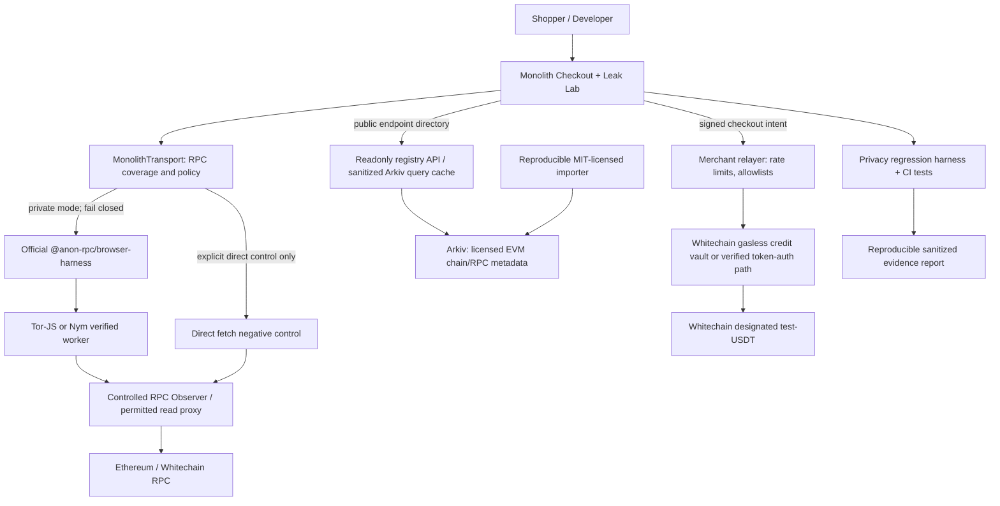

# MONOLITH — Final Verified Project Blueprint

**Current target update — 7 November 2026:** The owner selected EF, Arkiv, Uniswap and Whitechain as development targets, including Whitechain Scale, Operate and Tokenize. Follow the [completion plan](track-completion-plan.md) and [current delivery plan](plan.md). The original v2 blueprint below preserves the earlier scope decision; its optional/conditional sponsor wording is historical and does not cancel the newly activated workstream. Implementation and evidence still follow their actual GitHub tasks.

**Product name:** Monolith — The Privacy Crash-Test Lab for Web3 Checkout\
**Tagline:** *Break your checkout's privacy. Fix the leak. Prove the payment still works.*\
**Version:** 2.0, architecture and implementation specification\
**Research date:** 6 November 2026, Asia/Kolkata\
**Event:** ETHGlobal Mumbai 2026\
**Team assumption:** Four engineers\
**Implementation status:** **Design validated against published documentation; no code, contract deployment, testnet payment, Arkiv entity, Tor circuit, or Anon-RPC end-to-end execution is represented as completed.**\
**Primary submission:** Ethereum Foundation — **Best Use of Anon-RPC**\
**Secondary submission:** Arkiv — **Mirror something Ethereum depends on**\
**Conditional third submission:** Whitechain — **Scale: Payments Nobody Notices**\
**Source of truth:** [Official ETHGlobal prize page](https://ethglobal.com/events/mumbai/prizes)

> **One-sentence pitch:** Monolith is a privacy regression-testing toolkit with a playable "Leak Lab": it shows exactly what an RPC provider learns about a wallet or payment checkout, routes blockchain reads through real Anon-RPC anonymity transport, catches newly introduced direct-RPC leaks, and validates a merchant-sponsored gasless USDT checkout on Whitechain using public network configuration mirrored into Arkiv.

## Decision in one minute

**Choose this product, not three disconnected sponsor demos.** The distinctive feature is a test that initially **fails when a privacy leak is injected**, then **passes after a verified routing change**, while the genuine Whitechain checkout continues to work. The Arkiv dataset supplies real chain/RPC configuration data; the Anon-RPC worker is the actual protected transport; Whitechain provides an honest payment workflow with a visible onchain USDT receipt.

**Highest-priority proof:** a real Anon-RPC-protected read and controlled direct-vs-anonymous RPC comparison. If that fails, stop building ancillary sponsor integrations. **Second:** runnable Arkiv import + query. **Third:** real gas-sponsored Whitechain test-USDT settlement. There is no required AI model, fictional anonymity score, or unnecessary agent wallet.

**Scope gate:** EF + Arkiv is the viable two-sponsor core; Whitechain is a tightly defined payment demonstration only after the first two are operational. This guards against overbuilding with four developers.

---

## 1. Product, problem, and intended buyers

### The problem

A wallet, explorer, token-balance widget, or merchant checkout routinely asks Ethereum JSON-RPC endpoints questions such as `eth_getBalance`, `eth_call`, `eth_getLogs`, and `eth_getTransactionReceipt`. On a direct connection, the endpoint may connect the request's apparent network source with the addresses and methods in its request body. Wallet operators sometimes introduce privacy routing for one component while another widget or retry path still connects directly. An app can appear private in a settings menu while its implementation leaks metadata.

Even a properly anonymized transport does **not** hide wallet addresses in JSON-RPC payloads from the ultimate RPC endpoint. It also does not conceal addresses and transfers recorded on a public blockchain. This product makes both protection **and residual exposure** visible.

### Who uses it

1. **Web3 checkout developers:** verify that the balance and status lookups surrounding a payment are anonymized, and that a payment flow still works.
2. **Wallet/portfolio engineers:** adopt a privacy-safe JSON-RPC transport, test every route, and fail CI on accidental direct-RPC calls.
3. **Privacy and application-security teams:** get reproducible artifacts demonstrating which data leaves the client, how, and under whose trust boundary.
4. **RPC infrastructure maintainers:** publish, discover, and audit redistributable chain/RPC configuration data; measure endpoint behavior and freshness.

### Why they might pay

Enterprise buyers don't pay merely to see a Tor logo. They pay for **repeatable regression checks**, policy enforcement, integration support, CI evidence, and fewer privacy incidents across code changes. This is a customer-development hypothesis, not confirmed demand.

### What we deliberately do not build

- A new anonymizing network, new zk proof, or a private stablecoin.
- An unqualified claim that Whitechain onchain transfers become anonymous.
- A wallet that holds real users' production private keys.
- A universal inspector capable of observing every third-party dApp without instrumentation.
- A generic LLM chatbot, autonomous marketplace, or contract-security scanner.
- A high-maintenance merchant suite with subscriptions, refunds, payroll, and treasury features.

---

## 2. Sponsor selection: exact fit, proof, and kill criteria

### EF — Best Use of Anon-RPC (primary)

- **Advertised pool:** $5,000; 1st $2,500, 2nd $1,500, 3rd $1,000.
- **Required:** app routes its **RPC reads via Anon-RPC by default**. Worker/harness developers have a separate path; we're building an app.
- **Judged on:** end-to-end function, UX, coverage of app RPC traffic routed through Anon-RPC, deployability, technical depth.
- **Our proof:** `AnonRpcWorker` with a real Tor-JS or Nym worker (never the passthrough worker as proof of anonymity); inspector confirms outcome; direct mode is a clearly labeled opt-in negative control; introduce a direct call and watch CI fail.
- **Kill:** only the passthrough worker works, or the ordinary checkout still makes unreported direct reads. **Do not claim qualification.**

Official: https://ethglobal.com/events/mumbai/prizes and https://ethereum.github.io/anon-rpc/wallets/

### Arkiv — Mirror something Ethereum depends on (secondary)

- **Advertised pool:** $4,000; 1st $3,000, 2nd $1,000.
- **Required:** publicly useful **redistributable** data, not Sourcify; import script in repo, actual entities written to current Arkiv testnet, real Arkiv query used in product, imported data license linked, wallet address(es), reproducible query, and specified `/arkiv/*.md` documents.
- **Our data:** [ethereum-lists/chains](https://github.com/ethereum-lists/chains) (MIT-licensed) chain and RPC metadata; potentially add separately sourced official Whitechain RPC configuration with its own provenance if its reuse is permitted.
- **Our proof:** rerun import, show source snapshot hash, Arkiv write transaction/entity IDs, independent query, entity freshness and derived endpoint selection for Monolith, then reject a bad chain-ID endpoint.
- **Kill:** a handful of manually seeded listings; unlicensed source data; Arkiv installed but no actual read changes the visible application. **Do not claim Mirror qualification.**

Official: https://ethglobal.com/events/mumbai/prizes and https://docs.arkiv.network/

### Whitechain — Scale: Payments Nobody Notices (conditional third)

- **Advertised pool:** $3,000; 1st $2,000, 2nd $1,000.
- **Required:** Whitechain Sepolia **chain ID 1874**; deployed **and verified** contract(s); actual settlement with specified **test-USDT** contract `0xcedfB56113143d55b2358b8CFbB0dEB5Ad2f55a7` (not a self-minted token); explorer receipt; no WBT gas requirement for **payer**; demonstrate merchant gas sponsorship and abuse controls; public repo, **2–4 minute demo video**, `WHITECHAIN_FEEDBACK.md`, README explanation of why Whitechain settlement is useful.
- **Our proof:** shopper authorizes checkout without owning WBT, merchant's relayer pays WBT, test-USDT moves to merchant in main user flow, browser uses protected Anon-RPC reads for balance/status, both the privacy report and chain receipt are shown.
- **Kill:** payer pays WBT gas; no real specified test-USDT settlement; only a mocked checkout; relayer can be drained without basic limits. **Do not claim qualification.**

Official: https://ethglobal.com/events/mumbai/prizes and https://docs.whitechain.io/learn/network/testnet

### Important award interpretation

The pools total **$12,000 in category-wide advertised funding**, **not** the amount one team is expected to win and not a guaranteed payout. A project can choose up to three sponsor programs per event rules; verify selection limits and current dashboard eligibility. EF has an explicit rule that a project receives **at most one EF prize** even if submitted to multiple EF subtracks. Arkiv likewise restricts a team to one main Arkiv track prize, with a separate Swarm bonus if eligible. We are **not** planning on EF CROPS as an additional independent payout.

### Why not alternate combinations?

| Combination | Decision | Reason |
|---|---|---|
| EF + Arkiv Mirror + Whitechain Scale | **Chosen, gated** | Each has a distinct visible role in the same checkout privacy product |
| EF + Whitechain Scale only | **Strong fallback** | Avoids dataset engineering if Arkiv Mirror cannot be completed honestly |
| EF + Arkiv Mirror only | **Core fallback** | Best integrity of the privacy product; Whitechain is operationally the riskiest |
| EF + Chainlink CRE | Defer | A release gate on a simulated workflow adds orchestration but may not improve the lead privacy demonstration |
| EF + ENSv2 | Defer | Delegated record management is a real feature but is not necessary for privacy test coverage |
| EF + Whitechain Operate | Defer | Demands full merchant workflow and after-payment features; Scale is a better constrained target |
| EF + Arkiv Build on Arkiv | Alternate, not simultaneous pitch | If the mirror quality is insufficient, genuine wallet-owned expiring privacy-test reports could qualify for Build **only** with real application reads and all required documentation |
| EF + Arkiv + Swarm bonus | Stretch only | Requires actual Swarm uploads, postage-stamp evidence and the precise `/arkiv/swarm.md`; don't add for a token checkbox |

---

## 3. Precisely defined novelty

The EF prize page explicitly lists an Anon-RPC network health checker/playground as a desirable direction. Therefore the claim **"we built an Anon-RPC playground" is not novel by itself.** Privacy Pools and Kiwi News already integrate Anon-RPC. The `passthrough`, Tor-JS, Nym, and Nox workers already exist.

Our differentiation is the intersection of:

1. **Route-coverage contracts:** an SDK records the protected/direct decision for every instrumented wallet or checkout JSON-RPC read and fails closed when a privacy-required path would fall back to ordinary HTTP.
2. **Adversarial, reproducible privacy tests:** intentionally introduce direct-RPC calls, timeout failures, unsupported endpoints, and configuration tampering; fail build/tests when observed behavior violates expected policy.
3. **Residual-data visualization:** demonstrate **IP/network-path metadata protection without claiming payload confidentiality**; show address and method remaining visible to the destination.
4. **Public endpoint registry provenance:** real, licensed metadata mirrored into Arkiv; retrieved and used by the application under a trust and validation policy.
5. **Payment-workflow verification:** an actually executed gasless Whitechain USDT checkout is the representative sensitive workflow, not another toy portfolio screenshot.

**Testable core claim:** *If a wallet checkout starts reading blockchain state directly instead of through the required Anon-RPC transport, Monolith detects the regression, blocks or fails the relevant execution path, and reports an exact, reproducible counterexample without breaking properly routed checkout operations.*

### Existing prior art / competitor checks

- Official Anon-RPC SDK and worker: the anonymity transport is **not our invention**.
- Privacy Pools and Kiwi News: Anon-RPC adoption exists.
- Network health and RPC monitoring tools: common; adding a chart is weak novelty.
- Static proxy or browser devtools can expose HTTP requests; Monolith must demonstrate **enforced RPC-path policy plus replayable CI** to stand out.
- This is **not a claim that nobody else implements privacy regression testing**. Validate the developer demand with wallet teams after the hackathon.

---

## 4. Threat model and privacy truths

| Observer | What they may see | What our architecture changes |
|---|---|---|
| Direct destination RPC | Apparent client IP, request method, addresses inside payload | Anon-RPC can change network-path origin when a real network works |
| RPC behind Tor/Nym | Exit/gateway address, method, addresses and request data | **Still sees JSON-RPC contents**; only the original path is better obscured |
| Anonymizing worker/provider | Requests it handles and route metadata | Sandboxed hash-pinned worker limits page privileges; it remains a trust-sensitive component |
| Arkiv public DB | Public chain/RPC metadata and publisher records | Store no individual user IPs, addresses of wallets being viewed, or private invoices |
| Monolith backend | HTTP request source for requests hitting it | Do not create user-address-specific backend queries or persistent IP logs; prefer isolated public configuration snapshots |
| Whitechain relayer | Transaction intent, payer authorization and destination | Explicitly **not** anonymous; should not get browser wallet secrets |
| Whitechain observers | Public transfer and contract events | **No privacy promise**; checkout is publicly auditable |
| Merchant | Customer order and payment | Privacy of merchant/customer relationship is out of scope of Anon-RPC |
| Passive network observer | Entry connection metadata and timing | Residual correlation/timing risks remain |

### Security/privacy invariants

- **P1:** Every instrumented `eth_*` read under `privacy_required=true` is sent via an initialized verified anonymizing worker, or **fails closed**. No ordinary RPC fallback.
- **P2:** The passthrough worker is always labeled `NOT_ANONYMIZED`; its success does not count toward anonymized traffic coverage.
- **P3:** Worker bootstrap specifier lookup is separately reported as **non-anonymous**; no silent exclusion from the trust disclosure.
- **P4:** Publicly exported reports contain no raw user IP, private keys, private addresses being inspected, merchant order payload, or stable session correlators.
- **P5:** RPC destinations must pass chain-ID and HTTPS origin checks and must not be taken blindly from untrusted Arkiv entities.
- **P6:** An anonymity network outage may interrupt the checkout's chain reads; it must never silently downgrade privacy protections.
- **P7:** If Whitechain is integrated, user private signing material stays client-side; only signed task-specific intents may reach the relayer.
- **P8:** An approved payment settles at most once for a unique authorization nonce under the payment contract's defined limits.

### Privacy language for judges

> "Our private mode anonymizes the *transport path* for supported JSON-RPC reads. It does **not** conceal the queried wallet address from the RPC endpoint, nor does it hide public USDT transfers. Our product measures and prevents unintentional direct-path leaks in the application we instrument."

This is both more honest and more technically impressive than claiming users are "100% anonymous."

---

## 5. System architecture



### Separate trust boundaries

- **Browser:** only user-facing wallet reads and signed authorization; holds the Anon-RPC worker; report generation can be local.
- **Observer:** for deterministic demonstration of direct versus anonymized network source; only permits safe `eth_*` reads, enforces allowlisted upstreams, and deletes short-lived log data.
- **Arkiv importer:** server/operator wallet writes public data. Read-only registry API may query Arkiv on a schedule; avoid user-session lookup keys.
- **Merchant relayer:** holds WBT testnet gas funds, but **never** gets a user's wallet private key; validates EIP-712 signatures/receipts/quotes and enforces rate limits.
- **Whitechain:** verifies payment-intent nonce and merchant destination in contract before moving the official USDT token.
- **CI:** replays routing tests with synthetic addresses and never carries production merchant/user keys.

### Three coherent user flows

**Flow A: privacy lab** — checkout widget reads balances directly under explicit comparison mode; controlled observer records expected source characteristics. Same read via real Anon-RPC worker shows changed egress; payload remains visible. UI distinguishes these two dimensions.

**Flow B: leak regression** — user enables privacy-required policy; a simulated widget bypasses `MonolithTransport`. Runtime wrapper or test-only network interceptor detects an unexpected direct request. CI test fails with exact call name, route and test seed. Repair re-routes the widget; test passes.

**Flow C: gasless purchase** — user sees a merchant checkout without chain/gas steps; configured account signs a scoped authorization; relayer pays WBT to execute genuine contract settlement in designated Whitechain USDT. Anonymous reads show payment/balance status; transaction details remain public.

**Arkiv dependency:** the checkout's network picker and endpoint validation pull chain ID, public RPC URLs, source revision and expiry from an Arkiv-backed mirrored dataset. If the record is stale, malicious, or inconsistent with `eth_chainId`, it is rejected. Thus Arkiv is visible in route choice and failure behavior, not just a log.

---

## 6. Concrete Anon-RPC implementation

### Official facts verified as of 2026-11-06

The Anon-RPC draft specification is **version 0.4.0, dated 2026-10-23**. The browser harness package is `@anon-rpc/browser-harness`. It constructs `AnonRpcWorker` with a specifier contract address and a bootstrap EIP-1193-style provider; it fetches and hash-verifies the network worker bundle, loads it in a sandbox, and exposes `worker.fetch(...)`. The **initial bootstrap lookup is not anonymized**. `isolationKey` is a hint whose effectiveness depends on the network worker.

Official: https://ethereum.github.io/anon-rpc/spec/ and https://ethereum.github.io/anon-rpc/wallets/

Documented worker examples (not health/availability guarantees):

| Worker | Specifier address | Intended use |
|---|---|---|
| Tor-JS, mainnet | `0x700dA3193D35fA54Cd3fBf29B66f2a2A0385659e` | Primary anonymizing candidate |
| Nym, mainnet | `0x3aCD9742C68F6d993066Ae25533e09b9e1f60eD0` | Second anonymizing candidate |
| Passthrough, mainnet | `0x4fd77be300f31c5fe6ab266d35d27750a3478d27` | **Negative control; not private** |
| Nox, Sepolia | `0x35133267A8F7EC35046a83DCA0f4Ca8A6e1b7A9A` | Optional experimental network |

The documented Tor browser worker uses a demo gateway; the guide warns its capacity is limited and it may disappear. Production requires controlled, reliable network infrastructure and appropriate source review.

### TypeScript integration sketch (API surface verified, credentials/config adapted)

```ts
import { AnonRpcWorker } from '@anon-rpc/browser-harness';

// Set up a trusted EIP-1193 bootstrap provider; first specifier read is NOT anonymous.
const bootstrapProvider = {
  request: ({ method, params }: { method: string; params?: unknown }) =>
    existingEthereumProvider.request({ method, params }),
};

const worker = new AnonRpcWorker({
  address: '0x700dA3193D35fA54Cd3fBf29B66f2a2A0385659e',
  config: { gateways: [processEnvOrExplicitTorGateway] }, // documented Tor-JS config
  preExisting: { rpcProvider: bootstrapProvider },
});

// This-bound method: CALL AS worker.fetch(...), don't detach it.
export async function privateRpc(
  rpcUrl: string,
  method: string,
  params: unknown[] = [],
) {
  const id = nextJsonRpcId();
  const res = await worker.fetch(rpcUrl, {
    method: 'POST',
    headers: { 'content-type': 'application/json' },
    body: JSON.stringify({ jsonrpc: '2.0', id, method, params }),
  });
  if (!res.ok) throw new Error(`Anon transport failed: ${res.status}`);
  const envelope = await res.json();
  if (envelope.id !== id) throw new Error('JSON-RPC response mismatch');
  if (envelope.error) throw new Error('RPC error (sanitized)');
  return envelope.result;
}

// On page teardown:
// worker.close();
```

**Implementation note:** `existingEthereumProvider`, `processEnvOrExplicitTorGateway`, and `nextJsonRpcId` above are application-defined placeholders, not built-in SDK names. Pin the installed package version and test this in the target browser. The official guide documents the worker constructor and worker-fetch calls, but does not promise Tor gateway availability or Whitechain endpoint compatibility.

### MonolithTransport policy

```ts
type RoutePolicy = {
  privacyRequired: boolean;
  allowedChains: string[];
  allowedMethods: string[];
  allowDirectDebugControl: boolean; // false in ordinary app mode
  failClosed: true;
};

type RpcTrace = {
  requestId: string;
  chainId: string;
  method: string;
  transport: 'anon-tor' | 'anon-nym' | 'direct-debug' | 'blocked';
  callsite: string;
  durationMs: number;
  success: boolean;
  bootstrap: boolean;
  payloadVisibility: 'rpc-endpoint-can-read';
};
```

Routing algorithm:

1. Assert method/chain is permitted by application policy.
2. Validate chain ID/endpoint from trusted registry snapshot (see section 8).
3. If `privacyRequired` and verified worker unavailable: **deny or surface a non-private mode consent step**; never switch without user action.
4. Issue `worker.fetch` and instrument duration/outcome.
5. Track direct debug mode separately; exclude it from protected-traffic numerator.
6. Never include full wallet addresses or raw request bodies in exported traces.
7. Treat signed tx submission as a distinct operation from protected RPC reads.

### Browser/transport constraints

- Use a browser app; the documented harness is **browser-only**, relying on a null-origin iframe and WebRTC-based KPS bridge.
- Web Workers and Tor can incur significant bootstrap latency; use explicit `BOOTSTRAPPING`, `READY`, `DEGRADED`, `BLOCKED` states rather than a spinner pretending success.
- Worker version pinning proves bundle integrity relative to the specifier, not that a network can never log or censor traffic.
- A provider may reject Tor/Nym egress or fail due to CORS or gateway restrictions; test against controlled compatible endpoint first.
- Use `isolationKey` only as an explicitly unverified request for circuit separation until worker behavior is established.
- Do not claim protection from ordinary page analytics, trackers, WebSockets not routed through the worker, or a user wallet's own remote network traffic.

---

## 7. How to prove privacy honestly: observer and coverage metrics

### Controlled RPC observer

Create an allowlisted test endpoint `POST /observe/rpc` that:

- accepts a minimal JSON-RPC read allowlist (`eth_chainId`, `eth_blockNumber`, `eth_getBalance`, `eth_call` on known safe demo contracts, `eth_getTransactionReceipt`),
- forwards read-only calls to a configured upstream chain node,
- produces synthetic test-case IDs to correlate direct and Anon-RPC calls,
- records the HTTP transport's **observed source class** (e.g., direct client vs exit/gateway) and a coarse, ephemeral diagnostic; **do not persist raw IP**,
- reports `method`, whether a wallet address was present in the JSON-RPC body, response result, timing, and whether this was a private or direct test,
- rejects write methods (`eth_sendRawTransaction` etc.) and denies arbitrary upstream URLs to avoid proxy abuse/SSRF,
- encrypts/omits operational logs and expires any session evidence quickly.

**Demonstration proof must be paired:** a successful Tor/Nym worker setup + an observer showing network-source differences. Seeing a different IP alone would not prove the whole network is secure; the worker selection and trust model still matter.

### Meaningful, non-fabricated metrics

Definitions:

```text
eligible instrumented RPC reads = all app-owned JSON-RPC reads under test
protected reads = reads sent via a real anonymizing worker (not passthrough)
protected coverage = protected reads / eligible reads
unprotected leaks = policy-required reads that bypass worker
completion rate = successful reads / attempted reads
latency = per-route p50/p95 for same methods over same target
anonymized egress evidence = observer's detected network-source class
```

Always show denominator, controlled environment and method selection. For example, `19/20 reads protected` is a specific result **only after tests actually run**. Do not manufacture a privacy rating, throughput or percentage in a README.

### Required regression tests

1. **Positive:** valid Ethereum read through Tor-JS or Nym returns expected chain result.
2. **Negative:** a direct fetch in `privacyRequired=true` triggers denial or failing test.
3. **No downgrade:** when worker times out, no direct RPC request occurs.
4. **Wrong endpoint:** `eth_chainId` mismatch rejects registry endpoint.
5. **Malicious registry entry:** another Arkiv account publishes matching schema name; trusted-owner filtering ignores it.
6. **Payload visibility:** observer still reports presence of wallet address in private-route RPC body.
7. **Passthrough label:** passthrough yields `NOT_ANONYMIZED` despite hash-pinning.
8. **Bootstrap disclosure:** app lists the initial specifier read as an explicit exception.
9. **Retry behavior:** retries stay on verified transport; never downgrade.
10. **Empty network:** no worker available => blocked privacy read; ordinary UI shows explicit error.
11. **Checkout:** Whitechain post-payment status read stays via protected route or fails closed.
12. **Coverage:** instrumented reads metric matches enumerated test fixture, not manually entered counts.

### Instrumentation completeness limitation

An app-level wrapper only sees calls deliberately routed through it. To detect a component bypassing the wrapper, use both:

- **runtime enforcement** in modules using `MonolithTransport` and a repository-level rule banning raw `fetch`/direct `viem.http` for configured production RPC hosts;
- **test-time network interception** via Playwright fixture to record requests to known RPC origins and compare against expected protected traces.

Neither proves no browser extension or third-party script can leak. To broaden detection, developers must add explicit integration adapters or egress enforcement. CI reports exact scope.

---

## 8. Arkiv registry: real dataset and trust-safe endpoint selection

### The mirrored source

- Primary upstream: [ethereum-lists/chains](https://github.com/ethereum-lists/chains), a widely used EVM chain/RPC metadata registry.
- Source code/data license: [MIT](https://github.com/ethereum-lists/chains/blob/master/LICENSE) (verify any individual third-party entries' additional conditions if present, retain notices).
- Upstream data examples: CAIP-2 chain ID, chain name, public RPC URL(s), explorers, native currency and status.
- Choose **substantive real coverage**, not 3 manually created records. Recommended import a meaningful eligible set (e.g. at least 100 distinct networks if available, as many valid public HTTPS RPC URLs as licensed and supported), recording **actual** counts in the final README.
- Exclude private API-key placeholders (`${...}`), non-HTTPS endpoints, unsupported transports, unsafe local/private addresses and malformed templates.
- Store source repository URL, immutable upstream commit SHA, retrieved-at timestamp, importer version and manifest hash.
- Separately manually curate verified Whitechain Sepolia details from Whitechain's official documentation if not present in upstream, with provenance marker `official-whitechain-docs`, not pretending they came from the MIT dataset.

### Arkiv testnet verified documentation

- Current testnet shown: **RABDI**, chain ID `7794095`.
- Public RPC: `https://rpc.rabdi.db-chain.testnet.arkiv.network`
- Indexer: `https://indexer.rabdi.db-chain.testnet.arkiv.network`
- Explorer: `https://rabdi.explorer.arkiv.network`
- Official SDK: `@arkiv-network/sdk`, typed schema/query API.
- Entities have **wallet ownership** and **expiry**; use fixed lifetimes and rotate fresh data rather than leaving dead entries unmaintained.

Docs: https://docs.arkiv.network/ and https://docs.arkiv.network/writing/expiration/

### Proposed entity schema

```ts
import { defineSchema, str } from '@arkiv-network/sdk/schema';

export const RpcSource = defineSchema('monolith.rpc.v1', {
  chain_id: str().indexed(),   // e.g. "1", "11155111", "1874"
  chain_name: str(),
  rpc_host: str(),             // sanitized HTTPS URL only
  network_type: str().indexed(),  // "ethereum", "evm-l2", etc.
  status: str().indexed(),     // "candidate", "verified", "rejected"
  source_url: str(),
  source_commit: str(),
  source_license: str(),
  snapshot_sha256: str(),
  observed_at: str(),
  measured_chain_id: str(),
});
```

**Important:** A valid schema name does **not** authenticate an Arkiv record. Anyone can publish an entity with the same tag. Trust writer identity using `.createdBy(publisher)`/`.ownedBy(publisher)` and validate the content. Never blindly proxy all public endpoints from the database.

### Write and query sketches using documented SDK shapes

```ts
import { ExpirationTime } from '@arkiv-network/sdk';
import { eq } from '@arkiv-network/sdk/query';

// walletClient/publicClient initialization follows the current Arkiv docs.
const record = await walletClient.createEntity(RpcSource, {
  chain_id: '1874',
  chain_name: 'Whitechain Sepolia',
  rpc_host: 'https://rpc.testnet.whitechain.io',
  network_type: 'evm-l2',
  status: 'verified',
  source_url: 'https://docs.whitechain.io/learn/network/testnet',
  source_commit: 'official-doc-snapshot',
  source_license: 'official-docs; check permitted reuse',
  snapshot_sha256: actualHash,
  observed_at: new Date().toISOString(),
  measured_chain_id: '1874',
}, { expiration: ExpirationTime.fromDays(3) });

const { entities } = await publicClient
  .select()
  .from(RpcSource)
  .createdBy(PUBLISHER_ADDRESS)
  .where(eq('chain_id', '1874'))
  .fetch();
```

The `Whitechain` record above is an **illustrative write** and must be omitted until you confirm redistribution terms for that official source. For the actual Mirror bounty, prioritize real MIT-licensed `ethereum-lists/chains` data. These snippets have **not** been compiled in a local project; the SDK API patterns are sourced from current official schema/create/query docs, and specific project types must be integration-tested.

### Reader and route selection logic

1. Server-side cron/importer reads allowed upstream metadata, validates source/TTL, and writes fresh Arkiv entities with its dedicated public publisher account.
2. A **shared** registry service queries Arkiv by public network ID, verifies record publisher identity and freshness, and publishes a sanitized public network manifest. **Do not attach a user's wallet address or session to Arkiv queries.**
3. Browser uses the public manifest to discover a candidate HTTPS RPC endpoint; if feasible, fetch manifest through `worker.fetch` as well to avoid a direct page-resource contact at that moment.
4. Browser or controlled observer issues `eth_chainId` on the candidate, using the required privacy transport. If it differs from the expected chain ID, reject.
5. Allowlisted endpoint host must not resolve to internal/private IP ranges or link-local addresses; use DNS revalidation server-side where probing is done, reject credential-bearing URLs.
6. Prefer documented RPC providers and note that alternative endpoint discovery is **not** proof of provider trustworthiness or anonymity compatibility.
7. If Arkiv is unavailable, use a **previously verified, signed local cache** with its age displayed. Do not pretend stale data came live from Arkiv.
8. Display original source and Arkiv record reference; public independent clients can query the same entities without requesting an API key from Monolith.

### Arkiv Mirror quality criteria

- **Reach:** show original upstream usage and provide a second read-only consumer CLI (`pnpm registry:query`) that fetches directly from Arkiv.
- **Why Arkiv:** third parties can query a wallet-published public snapshot independent of your proprietary backend; data has owner/expiry metadata. A central Postgres clone would not offer this same open chain-query interface, though a public conventional DB can provide many similar capabilities; be candid.
- **Quality:** source SHA, importer rerun, actual dataset count, expired/rejected ratio, queryable chain ID/status, refreshed timestamps, documented invalid-entry handling.
- **Friction:** real SDK/indexer problems and exact reproducible steps.

**Required Arkiv files:** `arkiv/schema.md`, `arkiv/friction.md`, `arkiv/reach.md`, `arkiv/why-arkiv.md`, `arkiv/data-quality.md`. Also include publisher wallet addresses, import command, example query, output sample and relevant license notices in README.

---

## 9. Whitechain: gasless USDT checkout that keeps privacy meaningful

### Verified onchain facts

- Whitechain Sepolia chain ID: **1874** (`0x752`).
- Official public RPC: `https://rpc.testnet.whitechain.io`.
- Explorer: `https://explorer.testnet.whitechain.io`.
- Native gas: **WBT**; gas paid by relayer/merchant, not customer in the Scale submission.
- Mandatory designated test-USDT address for the prize: **`0xcedfB56113143d55b2358b8CFbB0dEB5Ad2f55a7`**.
- Use `whitechainSepolia` from `viem/chains` after confirming package version.
- Test network and specified test tokens have no monetary value.

Official: https://docs.whitechain.io/learn/network/testnet and https://ethglobal.com/events/mumbai/prizes

### Two technically valid implementation routes, with a preflight gate

**Route A (preferred if supported by designated USDT): token-native gasless authorization**

1. Read the **actual deployed USDT contract code/ABI** and explicitly test whether it implements ERC-2612 `permit` or EIP-3009 `transferWithAuthorization` for the specific 0xcedf... token.
2. If it does, shopper signs a scoped message; merchant relayer submits a transaction and pays WBT.
3. Receiver gets actual designated USDT; record explorer receipt.
4. Bind chain ID, spender, nonce, destination and expiry. Never assume one authorization method without checking deployed bytecode and a successful test.

**Route B (reliable fallback if permit/EIP-3009 absent): gasless delegated payment from a prefunded customer-credit vault**

1. Merchant/test operator **pre-funds the vault with designated test USDT** and grants a particular demo shopper an internal credit balance. Disclose this *pre-funding* as a prototype limitation.
2. Customer account locally signs an EIP-712 intent: `payer`, `merchant`, `maxAmount`, `orderId`, `nonce`, `deadline`, `chainId`, `verifyingContract`.
3. Merchant relayer validates the intent and pays WBT gas to invoke `payWithIntent`.
4. Vault verifies a valid customer signature, unconsumed nonce, sufficient allocated user credit, allowlisted merchant and amount. It debits **the user's credit and the vault's actual designated test USDT**, transfers USDT to merchant and emits a receipt event.
5. The shopper never holds WBT or submits a gas-paying chain transaction; demonstrate both front-end shopper and merchant receipt.
6. This **is a prefunded-credit/custody demo**, not a production noncustodial bank account. Enterprise-grade self-custody would require a compatible smart account/paymaster or token-native authorization support, validated separately.

**Mentor gate:** Ask Whitechain representatives whether Route B, with genuine official test-USDT settlement and no shopper gas, is eligible for Scale. If not, implement Route A or a confirmed embedded wallet/paymaster solution; **do not claim qualification without an accepted gasless pattern**.

### Vault safety rules for Route B

```solidity
// PSEUDOCODE — not a compiled/deployed contract; see Foundry tests.
// USDT address is constructor-pinned to official designated test token.
// signers own their scoped authorization; relayer merely submits.
struct PayIntent {
  address payer;
  address merchant;
  uint256 amount;
  bytes32 orderId;
  uint256 nonce;
  uint256 deadline;
}

function payWithIntent(PayIntent calldata intent, bytes calldata sig) external {
  require(block.timestamp <= intent.deadline, "expired");
  require(approvedMerchant[intent.merchant], "merchant");
  require(!consumed[intent.payer][intent.nonce], "replay");
  require(verifyEIP712(intent, sig, intent.payer), "signature");
  require(credit[intent.payer] >= intent.amount, "funds");
  consumed[intent.payer][intent.nonce] = true;
  credit[intent.payer] -= intent.amount;
  USDT.safeTransfer(intent.merchant, intent.amount);
  emit PurchasePaid(intent.payer, intent.merchant, intent.orderId, intent.amount);
}
```

Implement with OpenZeppelin cryptography and ERC-20 safe transfer, signature and domain separation; use custom errors, reentrancy safeguards, administrative role separation and tests. This is **illustrative logic**, not an audit or production-safe contract.

### Payment invariants

- **W1:** A user cannot settle a payment with invalid, expired or chain-mismatched signature.
- **W2:** A nonce can settle at most once, even on relayer retry.
- **W3:** Merchant destination, amount and order ID cannot be substituted after signature.
- **W4:** A customer cannot exceed allocated credit; credits plus reserved/debited funds obey vault conservation.
- **W5:** Any relayer account has WBT gas and per-account gas/request caps; it cannot forward an arbitrary call target.
- **W6:** Whitechain checkout payment reaches the specified official test-USDT contract, verified by `Transfer` logs and contract state; don't rely on front-end toast alone.
- **W7:** Checkout status and USDT balance reads, if made by the browser's app, obey MonolithTransport privacy policy and do not silently fall back to direct RPC.

### Merchant abuse protection

Rate-limit signed-intent submissions; one relayer endpoint per fixed contract and allowed function; validate EIP-712 domain, nonce and maximum gas; deny arbitrary call data; bound maximum payment per test customer; verify token, chain and destination before signing; alert on repeated invalid signatures; separate admin and relayer keys. Log only order IDs and sanitized transaction data.

### Why this genuinely helps Whitechain

A reusable checkout demo supports business payments in stablecoins without asking shoppers to hold WBT. The novel Monolith layer verifies that reads around the checkout don't leak client-origin metadata through accidental direct RPC. The payment itself is still publicly visible; the integration is about **operational privacy hygiene**, not hidden transactions.

---

## 10. Reproducible privacy and endpoint sandbox

### Local fixture topology

```text
browser (Playwright or headed Chromium)
    |-- MonolithTransport with official worker (external Tor/Nym network when available)
    |-- direct RPC negative-control test
    |-- merchant demo checkout
observer (Fastify; read-only allowlist; ephemeral logs)
    |-- upstream Ethereum or Whitechain RPC
registry importer (TS script; source snapshot hash)
    |-- Arkiv testnet current chain
payment relayer (isolated API with demo WBT key)
    |-- Whitechain Sepolia
CI (Vitest + Playwright + Foundry)
    |-- intercept direct network egress and check invariants
```

### Sandbox cases

| ID | Scenario | Expected result | Evidence |
|---|---|---|---|
| GT-01 | Direct `eth_getBalance` negative control | Observer sees direct connection class, payload readable | Observer test ID |
| GT-02 | Same read through real Tor/Nym worker | Observer sees different egress class, payload still readable | Worker specifier + test ID |
| GT-03 | Developer inserts direct fetch under required privacy | CI fails and identifies method/callsite | Test report |
| GT-04 | Anon worker unavailable | Fail closed; no direct fallback | Interceptor log |
| GT-05 | Passthrough worker used | `NOT_ANONYMIZED` status | Worker selection |
| GT-06 | Registry response forged by other publisher | Rejected using owner/creator and provenance checks | Arkiv query results |
| GT-07 | Candidate endpoint wrong `eth_chainId` | Endpoint excluded | Chain-ID probe |
| GT-08 | Registry record expired | Fresh read excludes it; signed cache warning | Arkiv entity `$expiresAt` |
| GT-09 | Same Whitechain payout nonce replayed | Second tx reverts | Foundry and/or onchain receipt |
| GT-10 | Shopper owns no WBT | Checkout succeeds with relayer WBT gas | Account balance + tx |
| GT-11 | Payment status widget leaks direct RPC | Privacy CI fails even though payment succeeded | End-to-end trace |
| GT-12 | Repair injected checkout leak | Both privacy and payment regressions pass | Clean rerun |
| GT-13 | Observer blocks write RPC method | No arbitrary proxy transaction | Server log |
| GT-14 | Endpoint attempts localhost/private-network address | Rejected before fetch | Endpoint policy test |
| GT-15 | Public RPC returns 429 or timeout | App reports unavailable without direct downgrade | Failure trace |
| GT-16 | RPC payload contains wallet address while anonymized | Display RPC-endpoint payload exposure warning | Observer classification |

**Anonymity test disclaimer:** Only GT-02 performed with an actual documented anonymizing worker and observable network egress can substantiate the network-path claim. CI mocks alone are useful for software regressions, not proof of Tor/Nym anonymity.

### Controlled self-fixing harness: optional, minimal

The user-facing standout capability can include a **one-click repair preview**, but it should not auto-edit production code invisibly.

1. Test identifies `payments/status.ts:27` using `fetch(WHITECHAIN_RPC)` rather than the required `MonolithTransport`.
2. `monolith fix --dry-run` offers a deterministic codemod for *known supported patterns*, with before/after diff.
3. CI reruns **privacy tests and authorized checkout tests**; a patch which simply blocks every request fails functional acceptance.
4. If all tests pass, generate a reviewable PR; **human must approve**. No claim of general autonomous code repair.

This achieves the "break → repair → prove" experience without overpromising an unreliable LLM fixing arbitrary application privacy flaws.

---

## 11. Dashboard UX: making the infrastructure eye-catching

### Single-screen judge experience

Top row: two switches **Private mode ON** and **Leak injection**. Center: cartoon glowing browser/wallet ghost traveling across a small network map. Three lanes: `Direct RPC` (red exposure path), `Anon-RPC via Tor/Nym` (protected *network path*), and `Whitechain settlement` (public). Side panel: selected Arkiv RPC endpoint and source revision. Bottom: result timeline, privacy fail/pass tests, actual Whitechain transaction link.

### UI interaction details

- Clicking a read reveals **request method** and **payload visibility**, but no actual real-user wallet address in a public view.
- Clicking the ghost's mask shows the **selected worker specifier, hash status, and bootstrap exception**.
- A deliberately injected direct read visually lights up the red path, then opens a reproducible failure report.
- Clicking **Apply candidate repair (sandbox)** shows the diff, runs the same tests, and removes the red leak only if tests genuinely pass.
- Clicking **Pay 1 test-USDT** starts checkout; payer doesn't need WBT; follow the merchant relayer gas receipt and USDT Transfer log. **The payment path is never depicted as anonymous.**
- Source badges classify `OBSERVED LIVE`, `SDK/CHAIN CONFIG VERIFIED`, `SIMULATED`, `UNTESTED`, and `BLOCKED`—never mark simulated traffic as proven anonymity.

### Do not build

Full animated game physics, arbitrary multi-chain wallet management, social feed, 3D city, NFT pets, or general AI assistant. Invest UI time in the one visual comparison judges can understand in 15 seconds.

---

## 12. End-to-end API and contract interfaces

### Backend (illustrative REST contract)

| Endpoint | Request | Response | Notes |
|---|---|---|---|
| `GET /api/registry/chains` | `?chainId=1874` | sanitized chain+RPC snapshot, provenance, expiry | Queries Arkiv-backed cache; no user address |
| `POST /api/observer/read` | JSON-RPC read + synthetic test ID | result + ephemeral exposure diagnostic | Read-only, no arbitrary upstream |
| `POST /api/tests/run` | named scenario + run ID | queued/result and evidence ref | Sandbox only |
| `GET /api/tests/:id` | run ID | failures, callsites, metrics, evidence | No private data in public mode |
| `POST /api/checkout/quote` | merchant+order ID | signed/unsigned bounded quote | Expires promptly |
| `POST /api/checkout/submit` | typed signed payment intent | idempotency ID, tx state | Relayer only; no signing key |
| `GET /api/checkout/:orderId` | merchant-scoped ID | `pending/settled/failed/reconcile` | Authenticate order access |
| `GET /api/health` | none | service states | Discloses only non-sensitive status |

**Don't add transaction-sending behavior to the RPC observer.** The merchant relayer is a distinct allowlisted route.

### Contract surface (proposed)

- `grantCredit(address payer, uint256 amount)` — controlled demo funding; production assumptions documented.
- `payWithIntent(PayIntent, bytes signature)` — signed, expiry-limited, replay-safe test-USDT transfer.
- `getCredit(address payer)` — read-only; privacy-routed browser call.
- `setMerchant(address, bool)` — administrator-controlled allowlist.
- `pause()` — emergency control; owner role only.
- `PurchasePaid(payer, merchant, orderId, amount)` — public onchain receipt, not privacy-preserving by itself.

Use test-only roles and no upgradeability in the hackathon MVP unless strictly necessary. Restrict admin functions and verify contracts via explorer.

### Evidence artifacts

```text
artifacts/
  anon-worker.json          # specifier, chosen network, pinned bundle hash metadata
  rpc-comparison.json       # redacted direct vs anonymous observer evidence
  privacy-run.json          # run ID, route coverage, detected bypass
  registry-snapshot.json    # upstream sha, Arkiv entity keys, query and actual counts
  checkout-settlement.json  # deployed contract + tx hash + official token address
  verification-manifest.json# links to all observed artifacts
```

Do not pre-populate production evidence files with fictional hashes, screenshots or counts. The demo generator should create them after a real test run.

---

## 13. Suggested monorepo layout

```text
monolith/
  apps/
    dashboard/                  # Vite/React demo UI and checkout
    observer/                   # controlled read-only RPC observation API
    relayer/                    # Whitechain gas sponsor API (conditional)
  packages/
    transport/                  # AnonRpcWorker + enforceable route policy
    privacy-analyzer/           # reporting, coverage calculations, privacy invariants
    registry/                   # Arkiv typed schemas, importer and query helpers
    shared/                     # types, schemas, validation
  contracts/
    src/GaslessCreditVault.sol  # conditional Whitechain fallback
    test/                      # replay, signature, balance, role tests
    script/                    # deploy + verify
  scripts/
    import-evm-registry.ts
    validate-rpc-endpoints.ts
    export-evidence.ts
    registry-query-example.ts
  tests/
    e2e/
    privacy/
    fixtures/
  arkiv/
    schema.md
    friction.md
    reach.md
    why-arkiv.md
    data-quality.md
  evidence/
    .gitkeep
  WHITECHAIN_FEEDBACK.md
  README.md
  LICENSE
  .env.example
  pnpm-workspace.yaml
  package.json
```

Use TypeScript end-to-end, with React/Vite, `viem`, Arkiv SDK, official Anon-RPC harness, Fastify for small services, Vitest+Playwright, and Foundry only if the Whitechain contract path activates. This minimizes language and deployment overhead for four developers.

---

## 14. Milestones, team ownership, and cut lines

### Zero-hour preflight — do not skip

| Test | Owner | Proof required | If failed |
|---|---|---|---|
| Browser `AnonRpcWorker` boots Tor-JS or Nym and makes permitted RPC read | Engineer A | real result + worker metadata | Stop third-sponsor development; diagnose primary dependency |
| Controlled observer can receive request through anon worker | Engineer A/B | separate direct/anon observed-source diagnostics | Use controlled compatible endpoint; do not fake evidence |
| Arkiv importer can create a real entity and independently query it | Engineer B | writer address, entity key, tx hash, query | Keep EF-only product until resolved |
| Whitechain official USDT `decimals` and authorization capabilities inspected | Engineer C | contract verification/ABI + read checks | Select honest fallback; ask mentor |
| Whitechain relayer receives test WBT and selected official USDT | Engineer C | faucet and balances | Drop Whitechain claim if cannot settle |

### Team split

**A — Privacy transport:** Official harness integration, controlled privacy test, fail-closed logic, working E2E read.

**B — Arkiv registry:** Licensed source import, source provenance, SDK entities, public queries, route selection and malicious registry rejection.

**C — Whitechain checkout (after gates):** inspect USDT auth, choose route A/B, relayer, smart contract and real settlement receipt, anti-abuse safeguards.

**D — Harness + visual UI:** Coverage engine, Playwright test interception, leak injection, dry-run codemod, single-screen demo and evidence export.

### Minimal **must ship** scope

- Working real Anon-RPC read by default; direct-vs-private negative control.
- One real privacy-bypass test that fails, and correct fix that passes.
- Arkiv MIT-licensed public registry importer and real query affecting selection.
- Clear source/expiry trust rules and no false anonymity claims.
- A working direct-vs-anon observer comparison.

### Whitechain-specific activation conditions

- Testnet access, official USDT, relayer WBT and verified signing strategy are confirmed **before** writing much checkout code.
- At least one actual gas-sponsored official USDT transfer, with explorer link, is demonstrated.
- Checkout RPC reads use MonolithTransport by default.

**Never sacrifice a functioning EF Anon-RPC result to finish a half-functional gasless checkout.**

### Post-MVP stretch

- Nym worker compatibility, Tor/Nym latency dashboard.
- Browser extension integration.
- Privacy release gate for a second independently configured demo app.
- Signed curated registry publisher snapshots with multiple data sources.
- Enterprise SSO, policy-as-code and private runner.

---

## 15. Four-minute demo script

| Time | Action | Verification |
|---|---|---|
| 0:00–0:25 | Show an ordinary checkout balance read; ghost is exposed in direct comparison mode | Real read and observer result |
| 0:25–1:05 | Switch to private mode; app fetches chain RPC metadata from Arkiv-backed registry, verifies chain ID, then reads through real Tor/Nym worker | Arkiv query + worker specifier + changed observed egress |
| 1:05–1:35 | Reveal what RPC endpoint **still** sees: method and queried address. Show bootstrap trust note | Honest privacy model |
| 1:35–2:05 | Judge clicks **Inject Leak**; direct checkout status widget bypasses transport; leak lights up and test fails | Reproducible failing CI run |
| 2:05–2:40 | Apply deterministic sandbox codemod and rerun; privacy test passes while legitimate read still works | Real diff + passing tests |
| 2:40–3:25 | Shopper authorizes test-USDT checkout without WBT; merchant relayer sponsors gas; Whitechain receipt opens | Actual specified token, tx, contract, sponsor gas evidence |
| 3:25–4:00 | Show report: protected coverage, leak regression, Arkiv provenance, Whitechain explorer link | Redacted evidence bundle |

**If Whitechain not ready:** replace 2:40–3:25 with a second independent app using the Arkiv dataset, and an anonymity-network outage test that proves fail-closed behavior. Do **not** narrate a mock payment as a completed Whitechain integration.

---

## 16. Submission checklist for each sponsor

### Ethereum Foundation Anon-RPC

- [ ] Anon-RPC used for app's RPC reads **by default**.
- [ ] Real anonymizing worker and bootstrap metadata visible; passthrough labeled negative control.
- [ ] Functional end-to-end read and privacy leak regression.
- [ ] Browser integration, worker version/hash and meaningful traffic coverage documented.
- [ ] Trust assumptions and limits explained, especially payload visibility and bootstrap exposure.
- [ ] Open repo, reproducible instructions, appropriate video/evidence.

### Arkiv Mirror

- [ ] Import from a public useful dataset whose license permits republication, with license URL and notices.
- [ ] No Sourcify data; source commit and importer code published.
- [ ] Real writer wallet and Arkiv entity keys/tx receipts.
- [ ] Reproducible import and a meaningful direct query, including a second consumer.
- [ ] Main app actually reads Arkiv-derived data and uses it in route selection.
- [ ] Correct expiry and owner/creator filtering; dataset freshness and quality demonstrated.
- [ ] `arkiv/schema.md`, `friction.md`, `reach.md`, `why-arkiv.md`, `data-quality.md` populated with evidence.
- [ ] Public repo + open-source license + disclosure of AI-assisted development.

### Whitechain Scale (conditional)

- [ ] Whitechain Sepolia chain ID 1874, real verified deployed contracts.
- [ ] Official specified test-USDT contract used and transfer settled in main flow.
- [ ] Payer need not hold WBT or pay transaction gas; merchant relayer funds WBT.
- [ ] Relayer rate limit, nonce, fixed contract targets and merchant restrictions.
- [ ] Both payer and merchant views shown with real explorer receipt.
- [ ] README states why onchain stablecoin settlement is useful and production caveats.
- [ ] Public repo with demonstrable incremental changes, architecture, setup and limitations.
- [ ] `WHITECHAIN_FEEDBACK.md` and 2–4 minute video.

### ETHGlobal baseline

- [ ] Current dashboard partner-program selections checked (up to three programs, according to published event rules).
- [ ] Actual submission deadline verified **in ETHGlobal dashboard**. Third-party event listings disagree about **November 7 vs November 8, 09:00 IST**; don't rely on those listings.
- [ ] Demo shows real running implementation, not diagram-only architecture.
- [ ] Clearly separate newly built hackathon code from any existing assets.
- [ ] README and demo make no unverified claims about Anon-RPC traffic, settlements, adoption, or test outcomes.

---

## 17. Business model and enterprise roadmap

### Go-to-market wedge

**Open-source core:** `monolith` CLI and React transport SDK for developers building wallets, explorers, checkout flows, and other RPC-heavy apps.

**Initial enterprise product:** CI privacy regression suite integrated into pull requests, with policy-as-code, organization-private runner, reproducible traces, data retention controls and compliance-friendly evidence exports.

**Future product:** multi-wallet and multi-chain observability, tested RPC provider routing, merchant checkout SDK integrations, privacy posture snapshots across releases, and third-party validated endpoint directories.

### Buyer and willingness-to-pay tests

- 3 wallet or Web3 checkout development teams use the CLI in an existing repo.
- Each provides one RPC-read path to instrument; ask whether it has ever introduced a direct-RPC fallback accidentally.
- Run a privacy regression in CI and measure engineer setup time, false positives and impact on checkout success rate.
- Ask for a paid pilot with clear accepted test cases and organization-specific evidence requirements.
- Do not assume a privacy tool has enterprise demand merely because it qualifies for an EF prize.

### Revenue hypotheses, not facts

- Open source free for local developer use.
- Hosted/team tier might charge per repository or protected checkout integration.
- Enterprise license could include private CI runners, SSO and compliance support.
- Professional services only if necessary for initial integration and feedback.

Potential competition includes general API gateways, traditional browser devtools, security testing vendors and any future formal wallet-privacy tooling. Commercial differentiation depends on test reliability, easy integration and developer trust, not on a proprietary anonymity network.

---

## 18. Risk register and mitigations

| Risk | Severity | Mitigation |
|---|---|---|
| Tor-JS/Nym worker cannot reach desired RPC due to gateway/CORS/egress restrictions | Critical | Test with controlled observer first; try documented alternative worker; don't count passthrough |
| Official Anon-RPC harness interface or specifiers change | High | Pin package version; load current specifier metadata; document as-of date |
| False impression that Whitechain transfers are private | Critical | Separate RPC transport panel from public settlement panel and explain residual visibility |
| Arkiv Mirror dataset too small or not licensed | High | Import substantial MIT data with source commit and full compliance docs; no fake records |
| Arkiv record poisoning or endpoint SSRF | Critical | Trust creator/publisher, validate HTTPS/domain/IP and expected chain ID; only allowlisted observer upstreams |
| Checkout depends on undocumented USDT `permit` support | Critical | Inspect token code; route B fallback and mentor eligibility gate; no assumption of interface support |
| Custodial prefunded-vault demo mistaken for customer-funded production payment | High | Explicitly label credit pre-funding and noncustodial future roadmap |
| Browser leaks through Arkiv metadata or site analytics | High | No third-party trackers; cache shared public registry data, never per-wallet query; document backend exposures |
| Test suite misses bypassing direct calls | High | Playwright network interception + static code rule + configured egress-policy test; state scope |
| Business value unclear beyond a pretty demo | Medium | Show reproducible CI failure and second-client use, not only network map |
| Three sponsors overextend team | Critical | Gate sponsor 2 and 3; keep EF core intact |
| Competing hackathon privacy dashboards | Medium | Make regression failure/fix, truthful endpoint payload display and payment integration central |
| Demo infrastructure fails | High | Snapshot genuine evidence beforehand; have offline walkthrough clearly labeled as recorded earlier—not staged proof |

---

## 19. Readiness matrix: what is actually verified vs still to prove

### Verified from authoritative published sources (checked 2026-11-06)

| Assertion | Evidence |
|---|---|
| EF Anon-RPC $5,000 pool; primary app must route RPC reads through Anon-RPC by default | ETHGlobal prize page |
| Browser harness `@anon-rpc/browser-harness`, `AnonRpcWorker`, `worker.fetch` | Official Anon-RPC wallet guide |
| Passthrough is non-anonymizing; Tor-JS and Nym examples exist | Official adopter/worker pages |
| Spec draft 0.4.0 dated 2026-10-23; bootstrap read not anonymous | Official specification + wallet guide |
| Arkiv Mirror $4,000, reusable licensed dataset, rerunnable importer, read/write and documentation requirements | ETHGlobal prize page |
| `ethereum-lists/chains` distributes EVM chain/RPC metadata and is MIT licensed | Repository README + LICENSE |
| Arkiv Rabdi chain ID 7794095 and public RPC | Arkiv documentation |
| Arkiv SDK supports typed entities, expiry, `createEntity`, filtered query, owner/creator controls | Official Arkiv docs |
| Whitechain Scale $3,000, Sepolia 1874, official test-USDT address and explorer receipt required | ETHGlobal prize page |
| Whitechain gas token WBT and public Sepolia RPC details | Whitechain current network documentation |
| Whitechain viem supports `whitechainSepolia` | Whitechain official viem guide |

### **Unverified runtime integration risks** — must pass preflight before claims

| Assumption | Test required |
|---|---|
| Tor/Nym worker is live in browser today | Start worker and obtain real result and observed egress |
| Anon-RPC worker can reach Whitechain RPC | Protected `eth_chainId` to official RPC; compare expected 1874; test CORS/gateway |
| Controlled observer proxy is reachable through chosen anonymizing worker | Real request and transport diagnostics |
| Arkiv current testnet accepts our writes and queries | Real SDK tx/entity and query |
| Our importer can mirror enough meaningful licensed records | Run importer, count valid records and query independently |
| Specified Whitechain USDT supports permit/EIP-3009 | Inspect deployed ABI/code, call safe feature tests |
| Prefunded-credit vault qualifies for Scale if token lacks authorization interface | Ask Whitechain mentor; do not assume |
| Whitechain relay can settle and sponsor gas using actual official test-USDT | Deploy, verify, fund, sign and submit live test tx |
| Checkouts can complete with all browser reads private | End-to-end user test under transport policy |
| ETHGlobal exact submission cutoff | Confirm in official participant dashboard because external listings conflict |

**Verification statement:** This document validates **documentation, design coherence, and required test criteria**. It does **not** state that integrations were executed, services are currently live, or that sponsor eligibility has been awarded.

---

## 20. Verification sources (primary, live-read on 2026-11-06)

1. [ETHGlobal Mumbai official prize requirements](https://ethglobal.com/events/mumbai/prizes) — EF, Arkiv Mirror, Whitechain Scale qualification criteria and advertised award pools.
2. [Ethereum Anon-RPC wallet and app guide](https://ethereum.github.io/anon-rpc/wallets/) — browser harness, worker construction, Tor/Nym/passthrough, bootstrap, trust boundaries and custom fetch.
3. [Ethereum Anon-RPC draft specification](https://ethereum.github.io/anon-rpc/spec/) — v0.4.0, normative worker and harness requirements.
4. [Ethereum Anon-RPC adopters and workers](https://ethereum.github.io/anon-rpc/adopters/) — documented worker specifiers, Tor/Nym caveats and shipping adopters.
5. [Ethereum Anon-RPC implementation repository](https://github.com/ethereum/anon-rpc) — upstream source and reference code.
6. [Arkiv official documentation](https://docs.arkiv.network/) — Rabdi testnet and SDK.
7. [Arkiv define schema](https://docs.arkiv.network/schemas/define/) — `defineSchema`, indexed fields and trusted owner/creator warning.
8. [Arkiv create entity](https://docs.arkiv.network/writing/create/) — create options, required expiry, returned `entityKey` and `txHash`.
9. [Arkiv query/filter](https://docs.arkiv.network/querying/filter/) — `.where`, `.createdBy`, `.ownedBy` and indexed filters.
10. [Arkiv expiry](https://docs.arkiv.network/writing/expiration/) — expiry semantics.
11. [ethereum-lists/chains](https://github.com/ethereum-lists/chains) — source EVM metadata registry.
12. [ethereum-lists/chains LICENSE](https://github.com/ethereum-lists/chains/blob/master/LICENSE) — MIT licensing.
13. [Whitechain Sepolia official network reference](https://docs.whitechain.io/learn/network/testnet) — chain ID, gas token and RPC/explorer.
14. [Whitechain viem integration](https://docs.whitechain.io/build/dapps/use-viem) — `whitechainSepolia` configuration.
15. [Whitechain building guide](https://whitechain.io/blog/start-building-on-whitechain) — EVM tooling and testnet.

---

## 21. Final recommendation and non-negotiable cut list

**Final project:** **Monolith: The Privacy Crash-Test Lab for Web3 Checkout.**

- **Lead integration:** Ethereum Foundation Anon-RPC, with genuine anonymized browser RPC reads.
- **Second integration:** Arkiv Mirror, with a substantial redistributable Ethereum/EVM chain/RPC metadata dataset and live query affecting endpoint selection.
- **Third integration only after live preflight:** Whitechain Scale, with real gas-sponsored settlement in its specified testnet USDT and a two-party checkout.

**Final demo promise:** *"Break the privacy of this checkout on purpose, watch the leak appear, fix the specific call, prove the privacy regression is gone, and still complete a real gasless USDT payment."*

### Cut first if time is short

1. AI/LLM explanations and autonomous remediation.
2. Nym second worker (Tor-JS alone, if verified).
3. Historical trend graphs and hosted telemetry.
4. Merchant invoice/refund/subscription UI.
5. Swarm and fourth-sponsor integrations.
6. Whitechain entirely if real USDT/gasless settlement cannot be shown.

### Never cut

- **A real anonymity worker** (not passthrough).
- **An actual observed direct-versus-anonymous comparison**, with correct payload visibility explanation.
- **A real failing and passing privacy regression test**.
- **Trust-safe endpoint registry if claiming Arkiv**.
- **Genuine specified token, verified contract, sponsored gas and explorer receipt if claiming Whitechain**.

The hackathon winner narrative should be the *privacy failure caught and repaired with measured proof*, not a list of blockchains integrated.
