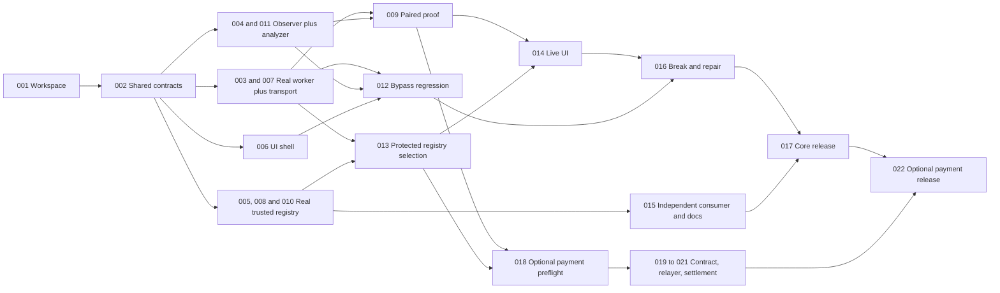

# Monolith team delivery plan

This plan turns [the idea](idea.md) into small branches that four teammates and their agents can own. It defines future implementation work; no integration, deployed contract, imported dataset, privacy result or payment is represented as completed.

Use the shared [Agents view](https://github.com/Dijo-404/monolith/issues/views/MDQ6VmlldzI4MjE3) to claim and update GitHub issues. [tasks.json](tasks.json) is the versioned task specification: stable IDs, branch names, dependencies, path ownership, acceptance criteria and required evidence. GitHub issues hold the live assignee, status, blockers and PR links. Follow [CONTRIBUTING.md](../CONTRIBUTING.md) for branch and handoff steps, [AGENTS.md](../AGENTS.md) for agent rules, and [architecture.md](architecture.md) plus [contracts.md](contracts.md) for implementation boundaries.

## Outcome and gates

The core demo must run a genuine Anon-RPC read, compare its observed path with an explicit direct control, detect a newly injected direct-RPC leak, repair it and rerun the same functional tests. A real Arkiv import/query must supply the endpoint selection. The destination still sees JSON-RPC payloads, and worker bootstrap is disclosed as non-anonymous.

| Gate | Pass evidence | Decision on failure |
|---|---|---|
| Foundation | MN-001 and MN-002 merged; shared DTOs and fixtures available | Keep implementation branches local to their owned paths; review interfaces before cross-module wiring |
| Anon-RPC feasibility | MN-003 real browser read via Tor-JS or Nym | Timebox diagnosis; pause ancillary sponsor work. Passthrough is never a substitute |
| EF runtime proof | MN-009 real paired worker/observer comparison | Treat inconclusive source evidence as unresolved; no successful anonymity claim |
| Arkiv feasibility | MN-005 actual write and independent trusted query | Keep privacy work moving; if unresolved, remove the Arkiv qualification claim |
| Arkiv product use | MN-013 actual Arkiv-derived endpoint selection with a protected chain-ID probe | Block registry-dependent routing or clearly identify an explicitly permitted verified cache; no invented live registry result |
| Core release | MN-017 accepted after all required core evidence and checks | Record blockers and continue fixing; a drafted report alone cannot close the release |
| Whitechain activation | MN-009 and MN-013 live evidence, then MN-018 proves token/funding/accepted route | Cut optional payment tasks and assign lane C to core hardening |
| Whitechain release | MN-022 actual specified-USDT settlement, verified contract and sponsored gas evidence | Keep the core release; omit Whitechain qualification claims |

The planned delivery target is EF + Arkiv. If Arkiv remains unavailable, the owner can publish an explicitly reduced EF-only demo using configured, approved endpoint fixtures without claiming Arkiv completion; record that scope change in the affected issues. A different sponsor fallback requires a deliberate scope decision. Whitechain never becomes a dependency of the core release.

## Four parallel lanes

Lanes are suggested responsibilities, not assigned people. A teammate claims an issue before starting; another available teammate can take a ready issue in any lane.

| Lane | Primary work | Main path boundary | Reallocation |
|---|---|---|---|
| A — Privacy transport | Worker preflight, transport policy, protected endpoint validation | `packages/transport/`, dashboard transport/registry composition, shared contracts during MN-002 | Review transport and browser egress failures after integration |
| B — Registry | Arkiv preflight, licensed import, trusted query, independent consumer | `packages/registry/`, registry API adapter, registry scripts and `arkiv/` | Help clean-clone verification and evidence if the registry gate fails |
| C — Observer and proof | Safe observer, paired proof, pure analyzer, core evidence | `apps/observer/` observer internals, `packages/privacy-analyzer/`, comparison/export scripts | Optional payment work only after gates; otherwise improve core reliability |
| D — UI and regressions | Initial workspace, dashboard, independent bypass tests, break/fix demo | Root setup initially, `apps/dashboard/` features, browser/static regression checks | Optional checkout UI only after relayer acceptance |

The root lockfile, workspace manifests, shared contracts and application composition roots are shared bottlenecks. MN-001 owns the initial workspace changes; MN-002 owns the first shared schema. Subsequent tasks change only their listed paths. Coordinate a dependency/schema change in the issue before editing another owner's area. A single owner updates a shared lockfile for a dependency change; other branches rebase rather than committing unrelated lockfile churn.

## Chunk list

Estimates are active engineering time for a focused task, generally one to three hours, and exclude merge waits, faucet waits and external service failures. Stop the bounded preflights at their timebox and report the observed blocker. Split any task that grows beyond one reviewable PR; keep the stable parent issue and record the new dependencies. These estimates are not a promised event deadline.

| ID | Chunk | Lane | Depends on | Estimate |
|---|---|---|---|---|
| MN-001 | Workspace and baseline checks | D | — | 1–2h |
| MN-002 | Shared contracts and synthetic integration fixtures | A | 001 | 1–2h |
| MN-003 | Real browser Anon-RPC preflight | A | 002 | 45–90m |
| MN-004 | Controlled read-only observer | C | 002 | 2–3h |
| MN-005 | Real Arkiv write/query preflight | B | 002 | 45–90m |
| MN-006 | Dashboard shell with honest source states | D | 002 | 1–2h |
| MN-007 | Fail-closed MonolithTransport | A | 003 | 2–3h |
| MN-008 | Licensed, rerunnable registry importer | B | 005 | 2–3h |
| MN-009 | Paired direct/anonymous observer proof | C | 004, 007 | 1–2h |
| MN-010 | Trusted registry snapshots and endpoint policy | B | 008 | 2–3h |
| MN-011 | Measured privacy analyzer and redaction | C | 002, 004 | 1–2h |
| MN-012 | Direct-bypass detection and CI | D | 006, 007, 011 | 2–3h |
| MN-013 | Registry-to-protected-transport wiring | A | 007, 010 | 1–2h |
| MN-014 | Dashboard wired to live state | D | 006, 009, 011, 013 | 2–3h |
| MN-015 | Independent registry consumer and Arkiv docs | B | 010 | 1–2h |
| MN-016 | Real leak, repair and rerun walkthrough | D | 012, 014 | 1–2h |
| MN-017 | Core evidence and clean-clone release | C | 009, 012, 013, 014, 015, 016 | 2–3h |
| MN-018 | Optional Whitechain token/funding/route preflight | C | 009, 013 + activation gate | 1–2h |
| MN-019 | Optional signed payment contract and verification | C | 018 | 2–3h |
| MN-020 | Optional merchant relayer and reconciliation | C | 019 | 2–3h |
| MN-021 | Optional protected checkout and actual settlement | D | 014, 020 | 2–3h |
| MN-022 | Optional Whitechain evidence and final demo | C | 017, 021 | 1–2h |

Use the full `MN-xxx` identifiers in issues and branches. The two-digit `GT-01`–`GT-16` identifiers in the original idea are test scenarios, not task IDs. Each issue lists its exact branch and the evidence needed for review; no ticket is complete merely because a file with the expected name exists.

## Working order

| Wave | A | B | C | D |
|---|---|---|---|---|
| Foundation | Isolated MN-003 experiment immediately; MN-002 after MN-001 | Isolated MN-005 experiment immediately; review license and publisher setup | Review observer deployment, allowlists and proxy behavior | MN-001 |
| Feasibility and isolated slices | MN-003 → MN-007 | MN-005 → MN-008 | MN-004 → MN-011; MN-009 once MN-007 lands | MN-006; start MN-012 once MN-007 and MN-011 land |
| Product integration | MN-013 after MN-010; review egress checks | MN-010 → MN-015 | MN-009 if pending; prepare evidence format and failure replay | Finish MN-012 → MN-014 once all live inputs land |
| Core acceptance | Review chain mismatch and worker outage cases | Reproduce independent public query and check counts | MN-017 after required D work; use spare time for bounded MN-018 if activated | MN-016 after MN-012 and MN-014 |
| Optional payment | Review protected Whitechain reads | Help evidence/provenance or core fixes | MN-018 → MN-019 → MN-020; then MN-022 after MN-021 and core acceptance | MN-021 after MN-020; keep existing core acceptance green |

Each lane has one active owner at a time. MN-014 and MN-016 both belong to D and run sequentially. C serializes MN-004, MN-011/MN-009 and MN-017; MN-009 can precede MN-011 if the transport lands first. C can use the waiting period before the final core walkthrough for the bounded optional preflight, but core acceptance takes priority when it becomes ready. Do not start several tasks simply because multiple issues are technically ready.

The two main critical paths are:

- `MN-001 → MN-002 → MN-003 → MN-007 → MN-009 → MN-014 → MN-016 → MN-017`
- `MN-001 → MN-002 → MN-005 → MN-008 → MN-010 → MN-013 → MN-014 → MN-016 → MN-017`

The analyzer and bypass-CI path also feeds MN-016. If either real-network path stalls, communicate it immediately; extra animation or optional contracts cannot resolve that dependency.

## Task status and handoffs

Only MN-001 is initially ready for normal integrated implementation. MN-003 and MN-005 may run bounded isolated feasibility experiments immediately: record experiment ownership and findings on the issue, branch from `docs/monolith-team-plan`, and touch only the listed spike paths and preflight report. Use a temporary isolated environment without editing shared manifests or the lockfile. Their formal dependency gate, integration and acceptance still wait for MN-002; rebase onto the merged foundation before review. This lets external failures surface at time zero while preserving a single workspace owner.

For normal implementation, an issue moves from `status:backlog` to `status:ready` when its dependencies have merged to `main` and its stated gate has evidence. Claim it with a human assignee and a comment naming the teammate's agent/session, owned paths and branch, then use `status:in-progress`. Follow the repository claim protocol to avoid simultaneous claims; GitHub assignment alone is not a distributed lock.

Update the issue whenever a blocker, dependency, path ownership or handoff changes. A useful update says what changed, links the branch/PR, lists commands actually run and their results, and names the next action. Use `status:blocked` with a specific unblock condition rather than leaving a stale in-progress task. Report a brief status at least before a work session ends; leave enough context for another agent to continue without this chat.

Open a focused PR, link its task and required evidence, then mark `status:review`. The user merges to `main`. After the merge, close the accepted issue and reassess its dependants for readiness. A branch, PR, passing fixture test or recorded design is not evidence of a real worker, Arkiv write or onchain settlement. Keep those distinctions in the task acceptance report.

## Scope cuts and completion

Cut animation polish, automatic codemods, extra anonymity networks, historical charts and hosted telemetry first. Drop Whitechain as a whole if its actual token, accepted gasless strategy, protected reads or sponsored settlement cannot be proven. C then owns observer reliability, redaction, external-failure cases and clean-clone evidence instead of payments.

Complete the core only when the functional read, independently observed route comparison, real bypass failure/repair, trusted Arkiv product use and independent query are supported by reproducible evidence. Run fast deterministic regressions on PRs; invoke live-network preflights separately and label their timestamp and result. Do not make a CI mock the basis for a live privacy claim. Final event submission choices and exact deadlines must be checked in the participant dashboard; this plan does not assume a cutoff from third-party listings.
